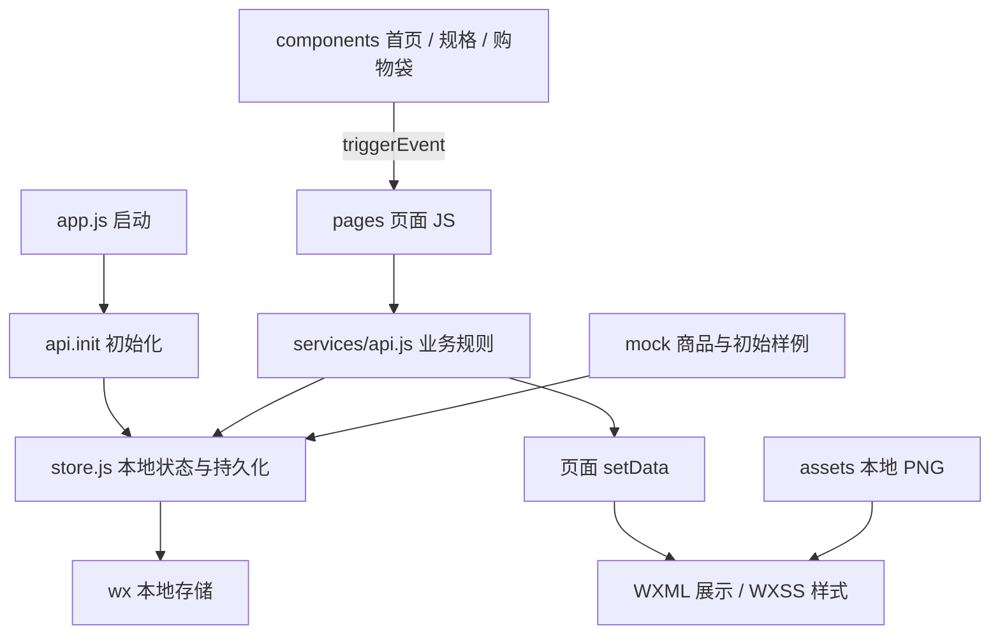

# 项目文件夹、文件作用与功能代码定位

核对日期：2026-11-04。项目根目录：`D:\大\小程序期末`。本说明根据现有 README、业务规则、演示步骤、测试记录、修复记录，以及当前磁盘上的源码整理。

文中的行号是**当前文件中的实际起始行**。点击“文件:行号”可定位代码；后续增删代码会使行号变化。部分文件采用紧凑写法，多个函数或样式写在同一行，因此需要结合表中的函数名、类名查找。图片、压缩包没有代码行号。

### 阅读导航

| 内容 | 点击位置 |
| --- | --- |
| 所有文件夹的用途 | [第2节](PROJECT_GUIDE.md?plain=1#L71) |
| 根配置、全局入口与5个组件 | [第3节](PROJECT_GUIDE.md?plain=1#L125) |
| 16个页面：逐个说明四件套文件 | [第4节](PROJECT_GUIDE.md?plain=1#L205) |
| 业务、存储、初始数据和公共工具 | [第5节](PROJECT_GUIDE.md?plain=1#L385) |
| 57张PNG与56份SVG逐个用途 | [第6节](PROJECT_GUIDE.md?plain=1#L535) |
| 开发脚本 | [第7节](PROJECT_GUIDE.md?plain=1#L646) |
| 测试文件与各用例位置 | [第8节](PROJECT_GUIDE.md?plain=1#L674) |
| 文档、根辅助文件和第三方依赖 | [第9节](PROJECT_GUIDE.md?plain=1#L724) |
| 结果报告与全部截图 | [第10节](PROJECT_GUIDE.md?plain=1#L759) |
| 按功能快速定位主要代码 | [第11节](PROJECT_GUIDE.md?plain=1#L819) |
| 四条完整功能调用过程 | [第12节](PROJECT_GUIDE.md?plain=1#L859) |
| 修改功能时先看哪里 | [第13节](PROJECT_GUIDE.md?plain=1#L892) |

建议先看第 2 节理解目录，再用第 11 节按功能查代码；需要逐文件讲解时阅读第 3–10 节。

## 1. 先理解项目如何工作

这是一个微信原生小程序，使用 WXML、WXSS、JavaScript 和 JSON。页面负责展示与接收操作，`services/api.js` 负责业务规则，`services/store.js` 负责本地保存。支付、会员资产、配送和物流均为本地课程演示逻辑。



例如，点击“加入购物车”会经过：**规格组件发出 add 事件 → 点单页 addProduct 接收 → api.addCart 校验价格、规格和库存 → store 提交并保存 → 点单页 refresh → WXML 显示新金额**。因此一个功能通常需要同时看页面交互和业务服务两处。

### 1.1 四种文件后缀分别做什么

| 后缀 | 初学者可以怎样理解 | 本项目中的内容 |
| --- | --- | --- |
| `.wxml` | 页面结构：画面上有什么 | 文字、图片、商品循环、条件显示、按钮事件绑定 |
| `.wxss` | 页面外观：这些内容怎样排列 | 棕色/奶油色、大小、边框、间距、弹层、安全区 |
| `.js` | 页面操作和数据：点击后做什么 | `Page()` / `Component()`、加载数据、响应输入、调用业务服务 |
| `.json` | 微信配置：这个页面如何运行 | 导航标题、自定义组件引用、`component: true`、滚动设置 |

同一目录中的四个 `index` 文件配合使用。页面 JS 的 `data` 经 `setData()` 更新后，WXML 中的 `{{变量}}` 会跟着变化；`bindtap="函数名"` 把点击交给 JS 中的同名处理函数。

### 1.2 各层代码怎样分工

| 层 | 目录或文件 | 主要责任 |
| --- | --- | --- |
| 应用与项目配置 | 根目录项目配置、`miniprogram/app.*` | 确定运行目录、入口、页面路由、四项 TabBar、全局样式 |
| 页面层 | `miniprogram/pages/` | 接收点击和输入，调用服务，展示返回结果 |
| 组件层 | `miniprogram/components/` | 三套首页、商品规格弹层、购物袋弹层；向父页面发出事件 |
| 业务层 | `miniprogram/services/api.js` | 校验商品、库存、金额、优惠券和订单状态，处理会员资产 |
| 存储层 | `miniprogram/services/store.js` | 读取、迁移、克隆、一次性保存状态快照 |
| 初始数据 | `miniprogram/mock/` | 商品定义和首次启动的演示账户、地址、订单、券与流水 |
| 公共辅助 | `miniprogram/utils/`、`styles/` | 路由、弹窗、金额显示、校验、基础色彩与纸纹 |
| 图片资源 | `miniprogram/assets/` | 小程序实际加载的本地 PNG |
| 开发与说明 | `scripts/`、`tests/`、`docs/`、`artifacts/` | 素材制作、检查测试、使用说明和测试证据 |

## 2. 每个文件夹的用途

```text
小程序期末/
├─ miniprogram/                 微信实际运行的源码目录
│  ├─ pages/                    16 个完整页面
│  │  ├─ home/                 首页，按风格选择首页组件
│  │  ├─ menu/                 点单、分类、搜索与购物车入口
│  │  ├─ checkout/             确认订单、信息填写、优惠券与金额
│  │  ├─ payment/              本地模拟支付与余额支付
│  │  ├─ success/              支付成功、取餐码与后续入口
│  │  ├─ orders/               订单列表、状态筛选
│  │  ├─ order-detail/         单笔订单详情和状态推进
│  │  ├─ mine/                 我的、资产入口、数据重置
│  │  ├─ member/               演示会员资料与权益
│  │  ├─ wallet/               模拟储值、余额流水
│  │  ├─ coupons/              领券、查看券、结算选券
│  │  ├─ points/               积分记录与积分兑换
│  │  ├─ addresses/            地址新增、编辑、删除与默认地址
│  │  ├─ themes/               猫咪、云朵、小狗风格选择
│  │  ├─ store/                演示门店介绍、地址与营业信息
│  │  └─ about/                项目介绍与演示边界
│  ├─ components/              可复用的视图和交互块
│  │  ├─ home-cat/             猫咪烘焙首页主体
│  │  ├─ home-cloud/           云朵蛋糕首页主体
│  │  ├─ home-dog/             小狗咖啡首页主体
│  │  ├─ spec-sheet/           商品规格、份数和预览小计
│  │  └─ cart-sheet/           购物袋列表、增减、清空、结算事件
│  ├─ services/                业务规则与本地状态存储
│  ├─ mock/                    商品和首次运行的样例数据
│  ├─ utils/                   页面公共操作与输入校验
│  ├─ styles/                  色彩变量与纸张纹理样式
│  └─ assets/                  小程序本地资源
│     ├─ illustrations/        首页大插画和空状态图
│     ├─ icons/                功能图标与小狗服务插画
│     ├─ products/             15 张商品插画
│     └─ tab/                  四项底部导航的普通/选中图
├─ scripts/                    制作素材、校验源码与原生截图工具
│  ├─ lib/                     供校验脚本和测试共用的组件检查逻辑
│  └─ asset-sources/           SVG 源稿，不属于小程序运行包
│     ├─ illustrations/        6 份首页/空状态源稿
│     ├─ icons/                27 份功能图标源稿
│     ├─ products/             15 份商品源稿
│     └─ tab/                  8 份导航图标源稿
├─ tests/                      业务、页面处理函数、组件回归测试
├─ docs/                       项目讲解、规则、演示、测试和修复记录
├─ artifacts/                  检查结果和素材预览图
│  └─ screenshots/            原生截图及工具诊断报告
└─ tools-cache/                可选开发依赖与本次讲解的临时整理材料
   └─ node_modules/            编译器、自动化工具及其第三方依赖
```

`tools-cache/node_modules/` 内的包由 npm 安装，下面按依赖包说明职责；本项目自己的页面、脚本、素材、配置和报告则逐项列出。运行小程序本身不需要这些开发依赖。

## 3. 根目录文件、全局入口与组件

### 3.1 应用入口、项目配置与公共样式

这些文件决定“小程序从哪里开始、能打开哪些页面、全局长什么样”。它们与 `pages/` 里的具体业务页面不同。

| 文件 | 文件的作用 | 主要代码位置 |
| --- | --- | --- |
| `project.config.json` | 微信开发者工具的共享项目配置。指定小程序源码根目录、编译类型、基础库、用户 AppID 字段及编译设置。 | 源码根目录 [第 3 行](../project.config.json#L3)；基础库 [第 5 行](../project.config.json#L5)；AppID 配置字段 [第 6 行](../project.config.json#L6)；保留开发包依赖文件 [第 13 行](../project.config.json#L13)；打包包含/忽略配置 [第 36 行](../project.config.json#L36)。 |
| `project.private.config.json` | 本机开发者工具产生的私有配置，主要记录本地编译、模拟器和调试偏好。应结合共享配置阅读；不是页面业务逻辑。 | 本机基础库 第 2 行（仅本机文件）；调试设置 第 5 行（仅本机文件）；当前热重载设置 第 18 行（仅本机文件）；本机开发文件裁剪设置 第 20 行（仅本机文件）。 |
| `miniprogram/app.js` | `App(...)` 注册整个应用；保存页面间临时传递的选中地址、优惠券和商品分类；启动时初始化本地业务数据。 | 应用注册 [第 2 行](../miniprogram/app.js#L2)；共享临时状态 `globalData` [第 3 行](../miniprogram/app.js#L3)；启动函数 `onLaunch()` [第 4 行](../miniprogram/app.js#L4)；调用 `api.init()` [第 5 行](../miniprogram/app.js#L5)。 |
| `miniprogram/app.json` | 小程序全局配置。登记 16 个页面、默认顶部导航样式和四个原生底部 Tab；首页是 `pages` 数组的第一项。 | 页面路由列表 [第 2 行](../miniprogram/app.json#L2)；窗口/导航颜色 [第 8 行](../miniprogram/app.json#L8)；TabBar 配置 [第 15 行](../miniprogram/app.json#L15)；四个入口从 [第 18 行](../miniprogram/app.json#L18)开始；sitemap 引用 [第 24 行](../miniprogram/app.json#L24)。 |
| `miniprogram/app.wxss` | 页面共享的基础样式：纸张背景、字体、棕色按钮、卡片、表单、空状态、底部固定操作区和减少动画设置。组件样式另在各组件自己的 WXSS 中维护。 | 引入色彩/纸纹 [第 1 行](../miniprogram/app.wxss#L1)；页面字体底色 [第 3 行](../miniprogram/app.wxss#L3)；页面内边距 [第 9 行](../miniprogram/app.wxss#L9)；卡片 [第 11 行](../miniprogram/app.wxss#L11)；主按钮 [第 21 行](../miniprogram/app.wxss#L21)；输入框 [第 32 行](../miniprogram/app.wxss#L32)；固定操作区 [第 52 行](../miniprogram/app.wxss#L52)；减少动画 [第 53 行](../miniprogram/app.wxss#L53)。 |
| `miniprogram/styles/tokens.wxss` | 集中声明纸色、品牌棕、文字棕、卡片色、线条色等 CSS 变量，作为配色定义和参考；现有部分样式仍直接写颜色值。 | 变量从 [第 2 行](../miniprogram/styles/tokens.wxss#L2)开始，品牌色 `--brown` 在 [第 5 行](../miniprogram/styles/tokens.wxss#L5)。 |
| `miniprogram/styles/paper.wxss` | 用内嵌 PNG 纹理给页面铺上纸张颗粒背景；不需要访问外部图片地址。 | 纸纹背景、重复尺寸均在 [第 2 行](../miniprogram/styles/paper.wxss#L2)。这是较长的 Base64 数据行。 |
| `miniprogram/sitemap.json` | 配置微信搜索对页面的索引规则；当前规则禁止所有页面被索引，用于本地课程演示。 | 全部规则在 [第 1 行](../miniprogram/sitemap.json#L1)。 |

### 3.2 五个自定义组件：每个文件具体负责什么

`components/` 放可由页面组合使用的界面块。三个首页不是三个页面路由，而是 `pages/home` 按主题选择的三个组件；两个弹层由 `pages/menu` 控制是否显示。

#### 3.2.1 `components/home-cat/`：猫咪烘焙首页

| 文件 | 作用与代码位置 |
| --- | --- |
| [index.js](../miniprogram/components/home-cat/index.js#L1) | [第 2 行](../miniprogram/components/home-cat/index.js#L2) 的 `letters` 数组保存 WELCOME 每个字母的角度、纵向位移；[第 4 行](../miniprogram/components/home-cat/index.js#L4) 的 `order()` 向父页面发出带履约方式的 `order` 事件；[第 5 行](../miniprogram/components/home-cat/index.js#L5) 的 `member()` 发出进入会员页的 `open` 事件。 |
| [index.wxml](../miniprogram/components/home-cat/index.wxml#L1) | 页面结构。[第 2 行](../miniprogram/components/home-cat/index.wxml#L2) 循环绘制弧形 WELCOME；[第 4 行](../miniprogram/components/home-cat/index.wxml#L4) 引用猫咪插画；[第 7 行](../miniprogram/components/home-cat/index.wxml#L7) 是门店自取按钮；[第 9 行](../miniprogram/components/home-cat/index.wxml#L9) 是全国邮寄按钮；[第 11 行](../miniprogram/components/home-cat/index.wxml#L11) 是会员卡。 |
| [index.wxss](../miniprogram/components/home-cat/index.wxss#L1) | 组件视觉样式。WELCOME 排版从 [第 4 行](../miniprogram/components/home-cat/index.wxss#L4)开始；插画尺寸在 [第 7 行](../miniprogram/components/home-cat/index.wxss#L7)；双入口布局在 [第 10 行](../miniprogram/components/home-cat/index.wxss#L10)；深棕会员卡在 [第 17 行](../miniprogram/components/home-cat/index.wxss#L17)；按压反馈在 [第 23 行](../miniprogram/components/home-cat/index.wxss#L23)。 |
| [index.json](../miniprogram/components/home-cat/index.json#L1) | 第 1 行的 `"component": true` 声明这是组件。 |

#### 3.2.2 `components/home-cloud/`：云朵蛋糕首页

| 文件 | 作用与代码位置 |
| --- | --- |
| [index.js](../miniprogram/components/home-cloud/index.js#L1) | [第 2 行](../miniprogram/components/home-cloud/index.js#L2) 的 `order()` 把履约方式、商品分类发给父页面，未指定方式时使用自取；[第 3 行](../miniprogram/components/home-cloud/index.js#L3) 的 `wallet()` 请求进入储值页。 |
| [index.wxml](../miniprogram/components/home-cloud/index.wxml#L1) | [第 2 行](../miniprogram/components/home-cloud/index.wxml#L2) 是云朵插画；[第 5 行](../miniprogram/components/home-cloud/index.wxml#L5)、[第 6 行](../miniprogram/components/home-cloud/index.wxml#L6)、[第 7 行](../miniprogram/components/home-cloud/index.wxml#L7) 分别为堂食、自取、外卖；[第 9 行](../miniprogram/components/home-cloud/index.wxml#L9) 是会员储值卡；[第 10 行](../miniprogram/components/home-cloud/index.wxml#L10) 是甜品/咖啡分类入口；[第 11 行](../miniprogram/components/home-cloud/index.wxml#L11) 是邮寄入口。 |
| [index.wxss](../miniprogram/components/home-cloud/index.wxss#L1) | 插画尺寸 [第 5 行](../miniprogram/components/home-cloud/index.wxss#L5)；品牌英文 [第 6 行](../miniprogram/components/home-cloud/index.wxss#L6)；三入口布局 [第 8 行](../miniprogram/components/home-cloud/index.wxss#L8)；储值卡 [第 13 行](../miniprogram/components/home-cloud/index.wxss#L13)；右侧 VIP 小卡 [第 17 行](../miniprogram/components/home-cloud/index.wxss#L17)；分类卡 [第 20 行](../miniprogram/components/home-cloud/index.wxss#L20)。 |
| [index.json](../miniprogram/components/home-cloud/index.json#L1) | 第 1 行声明 `component: true`。 |

#### 3.2.3 `components/home-dog/`：小狗咖啡首页

| 文件 | 作用与代码位置 |
| --- | --- |
| [index.js](../miniprogram/components/home-dog/index.js#L1) | [第 1 行](../miniprogram/components/home-dog/index.js#L1) 声明父页面传入的登录状态 `loggedIn` 和昵称 `nickname`；[第 2 行](../miniprogram/components/home-dog/index.js#L2) 的 `order()` 发送履约方式；[第 3 行](../miniprogram/components/home-dog/index.js#L3) 的 `open()` 发送目标页面；[第 4 行](../miniprogram/components/home-dog/index.js#L4) 的 `login()` 请求父页面演示登录。 |
| [index.wxml](../miniprogram/components/home-dog/index.wxml#L1) | 品牌/插画在 [第 2 行](../miniprogram/components/home-dog/index.wxml#L2)；根据登录状态显示问候与按钮在 [第 3 行](../miniprogram/components/home-dog/index.wxml#L3)；外送、堂食、自取在 [第 4 行](../miniprogram/components/home-dog/index.wxml#L4)；门店入口在 [第 6 行](../miniprogram/components/home-dog/index.wxml#L6)；积分/优惠券在 [第 7 行](../miniprogram/components/home-dog/index.wxml#L7)；邮寄在 [第 8 行](../miniprogram/components/home-dog/index.wxml#L8)。 |
| [index.wxss](../miniprogram/components/home-dog/index.wxss#L1) | 品牌布局 [第 5 行](../miniprogram/components/home-dog/index.wxss#L5)；白底欢迎卡 [第 9 行](../miniprogram/components/home-dog/index.wxss#L9)；服务入口 [第 14 行](../miniprogram/components/home-dog/index.wxss#L14)；棕色门店条 [第 19 行](../miniprogram/components/home-dog/index.wxss#L19)；权益卡 [第 22 行](../miniprogram/components/home-dog/index.wxss#L22)；邮寄横条 [第 28 行](../miniprogram/components/home-dog/index.wxss#L28)。 |
| [index.json](../miniprogram/components/home-dog/index.json#L1) | 第 1 行声明 `component: true`。 |

#### 3.2.4 `components/spec-sheet/`：商品规格弹层

| 文件 | 作用与代码位置 |
| --- | --- |
| [index.js](../miniprogram/components/spec-sheet/index.js#L1) | `product` 属性及观察函数从 [第 2 行](../miniprogram/components/spec-sheet/index.js#L2)开始：每次打开商品清空已选规格并重置数量。`close()` [第 8 行](../miniprogram/components/spec-sheet/index.js#L8) 发送关闭事件；`select()` [第 9 行](../miniprogram/components/spec-sheet/index.js#L9) 更新规格；`quantity()` [第 10 行](../miniprogram/components/spec-sheet/index.js#L10) 限制数量；`recalculate()` [第 11 行](../miniprogram/components/spec-sheet/index.js#L11) 计算规格加价、小计和必选是否齐全；`add()` [第 18 行](../miniprogram/components/spec-sheet/index.js#L18) 发送商品 ID、规格、数量，实际写入购物车由父页面调用业务服务。 |
| [index.wxml](../miniprogram/components/spec-sheet/index.wxml#L1) | [第 1 行](../miniprogram/components/spec-sheet/index.wxml#L1) 是遮罩及阻止冒泡；[第 2 行](../miniprogram/components/spec-sheet/index.wxml#L2) 是关闭按钮；[第 3 行](../miniprogram/components/spec-sheet/index.wxml#L3) 是商品介绍；[第 4 行](../miniprogram/components/spec-sheet/index.wxml#L4) 嵌套循环规格组与选项；[第 5 行](../miniprogram/components/spec-sheet/index.wxml#L5) 是数量加减；[第 7 行](../miniprogram/components/spec-sheet/index.wxml#L7) 是小计与必选未齐全时禁用的加入按钮。 |
| [index.wxss](../miniprogram/components/spec-sheet/index.wxss#L1) | 遮罩 [第 6 行](../miniprogram/components/spec-sheet/index.wxss#L6)；底部圆角面板及安全区 [第 7 行](../miniprogram/components/spec-sheet/index.wxss#L7)；滚动高度 [第 8 行](../miniprogram/components/spec-sheet/index.wxss#L8)；规格按钮 [第 28 行](../miniprogram/components/spec-sheet/index.wxss#L28)；选中状态 [第 29 行](../miniprogram/components/spec-sheet/index.wxss#L29)；禁用状态 [第 37 行](../miniprogram/components/spec-sheet/index.wxss#L37)。 |
| [index.json](../miniprogram/components/spec-sheet/index.json#L1) | 第 1 行声明 `component: true`。 |

#### 3.2.5 `components/cart-sheet/`：购物袋弹层

| 文件 | 作用与代码位置 |
| --- | --- |
| [index.js](../miniprogram/components/cart-sheet/index.js#L1) | [第 1 行](../miniprogram/components/cart-sheet/index.js#L1) 接收商品行 `items`、显示金额 `total`、件数 `count`；[第 2 行](../miniprogram/components/cart-sheet/index.js#L2) 集中实现 `close()`、`clear()`、`change()`、`checkout()`，通过事件把操作交给父页面。多个方法在同一物理行，因此都定位为第 2 行。 |
| [index.wxml](../miniprogram/components/cart-sheet/index.wxml#L1) | [第 1 行](../miniprogram/components/cart-sheet/index.wxml#L1) 是标题、件数、清空与关闭；[第 2 行](../miniprogram/components/cart-sheet/index.wxml#L2) 循环商品、规格、价格与加减按钮，并显示空购物袋插画；[第 3 行](../miniprogram/components/cart-sheet/index.wxml#L3) 显示合计与去结算按钮，空袋禁止结算。 |
| [index.wxss](../miniprogram/components/cart-sheet/index.wxss#L1) | 遮罩 [第 6 行](../miniprogram/components/cart-sheet/index.wxss#L6)；弹层及安全区 [第 7 行](../miniprogram/components/cart-sheet/index.wxss#L7)；空状态 [第 20 行](../miniprogram/components/cart-sheet/index.wxss#L20)；商品行 [第 22 行](../miniprogram/components/cart-sheet/index.wxss#L22)；数量按钮 [第 30 行](../miniprogram/components/cart-sheet/index.wxss#L30)；禁用状态 [第 34 行](../miniprogram/components/cart-sheet/index.wxss#L34)。 |
| [index.json](../miniprogram/components/cart-sheet/index.json#L1) | 第 1 行声明 `component: true`。 |

### 3.3 组件与页面怎样配合

组件把按钮点击转换成自定义事件，页面负责接收事件和调用业务服务。组件的 `triggerEvent('order', ...)` 并不直接创建订单。

| 调用链 | 代码位置与解释 |
| --- | --- |
| 注册首页组件 | [home/index.json 第 1 行](../miniprogram/pages/home/index.json#L1) 用 `usingComponents` 把三种标签映射到三个组件目录。 |
| 选择显示哪种首页 | [home/index.wxml 第 3 行](../miniprogram/pages/home/index.wxml#L3) 起根据 `theme` 选择组件，同时通过 `bind:order`、`bind:open`、`bind:login` 绑定父页面函数。 |
| 点击首页服务入口 | 子组件发出 `order` → [home/index.js 第 12 行](../miniprogram/pages/home/index.js#L12) 的 `onOrder()` 接收 `event.detail` → 确认履约方式 → 设置点单分类 → 跳转菜单。 |
| 小狗首页登录 | 子组件 `login` → [home/index.js 第 20 行](../miniprogram/pages/home/index.js#L20) 的 `onLogin()` 执行演示登录并更新传给组件的会员数据。 |
| 打开商品规格 | [menu/index.js 第 38 行](../miniprogram/pages/menu/index.js#L38) 设置 `product` → [menu/index.wxml 第 13 行](../miniprogram/pages/menu/index.wxml#L13) 条件渲染 `spec-sheet` 并传入商品。 |
| 加入购物车 | `spec-sheet.add()` → [menu/index.js 第 40 行](../miniprogram/pages/menu/index.js#L40) 的 `addProduct()` → `api.addCart()` 写入数据、关闭规格层并刷新页面。 |
| 打开和操作购物袋 | [menu/index.js 第 44 行](../miniprogram/pages/menu/index.js#L44) 控制显示 → [menu/index.wxml 第 14 行](../miniprogram/pages/menu/index.wxml#L14) 传入商品、金额、件数并绑定四种事件 → [第 46 行](../miniprogram/pages/menu/index.js#L46) 更新数量、[第 47 行](../miniprogram/pages/menu/index.js#L47) 二次确认清空、[第 48 行](../miniprogram/pages/menu/index.js#L48) 进入结算。 |

## 4. 页面目录：`miniprogram/pages/` 的16个页面

每个页面都有四个文件：`index.js`负责数据和事件，`index.wxml`负责界面结构和数据绑定，`index.wxss`负责视觉样式，`index.json`负责页面配置。以下行号已按当前源码核对；部分压缩排版把多个函数或CSS规则写在同一行，同一个行号可以对应多个功能。页面JS主要协调界面，金额、库存、积分等最终规则应继续查看业务服务。

### 4.1 `home/`

首页外壳：读取保存的风格，挂载猫咪、云朵或小狗组件，接收组件点单和跳转事件。

| 文件 | 作用与主要代码位置 |
| --- | --- |
| `index.js` | [onShow（5）](../miniprogram/pages/home/index.js#L5)：读主题/会员并更新标题；[onOrder（12）](../miniprogram/pages/home/index.js#L12)：接收方式/分类并前往点单；[onOpen（19）](../miniprogram/pages/home/index.js#L19)：接收组件跳转；[onLogin（20）](../miniprogram/pages/home/index.js#L20)：演示登录；[styles（24）](../miniprogram/pages/home/index.js#L24)：进入风格选择。 |
| `index.wxml` | [第2行](../miniprogram/pages/home/index.wxml#L2)：风格按钮；[第3行](../miniprogram/pages/home/index.wxml#L3)：猫咪分支；[第4行](../miniprogram/pages/home/index.wxml#L4)：云朵分支；[第5行](../miniprogram/pages/home/index.wxml#L5)：小狗分支及会员属性。 |
| `index.wxss` | [第1行](../miniprogram/pages/home/index.wxss#L1)：页面间距；[第2行](../miniprogram/pages/home/index.wxss#L2)：顶部横排；[第5行](../miniprogram/pages/home/index.wxss#L5)：英文页脚。 |
| `index.json` | [第1行](../miniprogram/pages/home/index.json#L1)：设置导航标题，并注册home-cat、home-cloud、home-dog组件。 |

### 4.2 `menu/`

点单主页面：分类、搜索、售罄拦截、履约选择、规格选购、购物袋和结算入口。

| 文件 | 作用与主要代码位置 |
| --- | --- |
| `index.js` | [onLoad（5）](../miniprogram/pages/menu/index.js#L5)：读分类与门店；[onShow（6）](../miniprogram/pages/menu/index.js#L6)：接收首页带来的分类；[refresh（12）](../miniprogram/pages/menu/index.js#L12)：刷新商品/金额/购物袋角标；[category（26）](../miniprogram/pages/menu/index.js#L26)：切分类并清搜索；[search（27）](../miniprogram/pages/menu/index.js#L27)：按名称跨分类搜索；[clearSearch（28）](../miniprogram/pages/menu/index.js#L28)：清空搜索；[switchMode（29）](../miniprogram/pages/menu/index.js#L29)：切换四种履约；[configure（33）](../miniprogram/pages/menu/index.js#L33)：桌号/取餐时间/地址；[openProduct（38）](../miniprogram/pages/menu/index.js#L38)：打开规格且拦截售罄；[addProduct（40）](../miniprogram/pages/menu/index.js#L40)：接收规格并加购物袋；[toggleCart（44）](../miniprogram/pages/menu/index.js#L44)：开关购物袋；[changeCart（46）](../miniprogram/pages/menu/index.js#L46)：增减商品；[clearCart（47）](../miniprogram/pages/menu/index.js#L47)：确认清空；[checkout（48）](../miniprogram/pages/menu/index.js#L48)：去结算。 |
| `index.wxml` | [第2行](../miniprogram/pages/menu/index.wxml#L2)：门店/履约；[第3行](../miniprogram/pages/menu/index.wxml#L3)：搜索框；[第5行](../miniprogram/pages/menu/index.wxml#L5)：分类；[第7行](../miniprogram/pages/menu/index.wxml#L7)：商品卡片；[第11行](../miniprogram/pages/menu/index.wxml#L11)：购物袋栏；[第13行](../miniprogram/pages/menu/index.wxml#L13)：规格组件；[第14行](../miniprogram/pages/menu/index.wxml#L14)：购物袋组件。 |
| `index.wxss` | [第18行](../miniprogram/pages/menu/index.wxss#L18)：左右分栏；[第28行](../miniprogram/pages/menu/index.wxss#L28)：商品卡片；[第45行](../miniprogram/pages/menu/index.wxss#L45)：底部购物袋栏。 |
| `index.json` | [第1行](../miniprogram/pages/menu/index.json#L1)：设置导航标题、禁用整页滚动，注册spec-sheet、cart-sheet组件。 |

### 4.3 `checkout/`

确认订单：按履约方式收集信息，选地址/券，显示报价并提交待支付单。

| 文件 | 作用与主要代码位置 |
| --- | --- |
| `index.js` | [onLoad（5）](../miniprogram/pages/checkout/index.js#L5)：生成提交token并预填联系人；[refresh（12）](../miniprogram/pages/checkout/index.js#L12)：接收选址/选券结果并重新报价；[input（28）](../miniprogram/pages/checkout/index.js#L28)：收集表单；[pickup（29）](../miniprogram/pages/checkout/index.js#L29)：选自取时间；[address（30）](../miniprogram/pages/checkout/index.js#L30)：去选址；[coupons（31）](../miniprogram/pages/checkout/index.js#L31)：去选券；[removeCoupon（32）](../miniprogram/pages/checkout/index.js#L32)：移除券并重算；[mode（34）](../miniprogram/pages/checkout/index.js#L34)：切履约方式；[submit（35）](../miniprogram/pages/checkout/index.js#L35)：busy防连点/建单/进入支付；[viewOrder（44）](../miniprogram/pages/checkout/index.js#L44)：查看已建订单；[menu（45）](../miniprogram/pages/checkout/index.js#L45)：回菜单。 |
| `index.wxml` | [第3行](../miniprogram/pages/checkout/index.wxml#L3)：履约信息；[第4行](../miniprogram/pages/checkout/index.wxml#L4)：桌号；[第5行](../miniprogram/pages/checkout/index.wxml#L5)：自取人/时间；[第6行](../miniprogram/pages/checkout/index.wxml#L6)：配送邮寄地址；[第9行](../miniprogram/pages/checkout/index.wxml#L9)：商品；[第10行](../miniprogram/pages/checkout/index.wxml#L10)：券及备注；[第11行](../miniprogram/pages/checkout/index.wxml#L11)：金额；[第13行](../miniprogram/pages/checkout/index.wxml#L13)：提交栏；[第15行](../miniprogram/pages/checkout/index.wxml#L15)：空袋或已建单提示。 |
| `index.wxss` | [第1行](../miniprogram/pages/checkout/index.wxss#L1)：安全区留白；[第3行](../miniprogram/pages/checkout/index.wxss#L3)：履约卡；[第11行](../miniprogram/pages/checkout/index.wxss#L11)：商品行；[第19行](../miniprogram/pages/checkout/index.wxss#L19)：券和备注。 |
| `index.json` | [第1行](../miniprogram/pages/checkout/index.json#L1)：设置确认订单导航标题；最终库存、运费与券校验交由services/api.js。 |

### 4.4 `payment/`

模拟支付：选择mock或本地余额，演示成功、取消、失败三种结果。

| 文件 | 作用与主要代码位置 |
| --- | --- |
| `index.js` | [onLoad（4）](../miniprogram/pages/payment/index.js#L4)：接收订单ID；[refresh（6）](../miniprogram/pages/payment/index.js#L6)：读取订单/余额；[method（7）](../miniprogram/pages/payment/index.js#L7)：选择支付方式；[result（8）](../miniprogram/pages/payment/index.js#L8)：调用支付服务并按结果跳转；[order（19）](../miniprogram/pages/payment/index.js#L19)：去详情；[wallet（20）](../miniprogram/pages/payment/index.js#L20)：去储值；[login（21）](../miniprogram/pages/payment/index.js#L21)：演示登录。 |
| `index.wxml` | [第2行](../miniprogram/pages/payment/index.wxml#L2)：金额/订单号；[第3行](../miniprogram/pages/payment/index.wxml#L3)：模拟声明；[第4行](../miniprogram/pages/payment/index.wxml#L4)：支付方式；[第5行](../miniprogram/pages/payment/index.wxml#L5)：登录储值；[第6行](../miniprogram/pages/payment/index.wxml#L6)：结果按钮及错误。 |
| `index.wxss` | [第5行](../miniprogram/pages/payment/index.wxss#L5)：金额；[第8行](../miniprogram/pages/payment/index.wxss#L8)：方式列表；[第16行](../miniprogram/pages/payment/index.wxss#L16)：取消失败按钮。 |
| `index.json` | [第1行](../miniprogram/pages/payment/index.json#L1)：设置模拟支付标题；不调用真实微信支付。 |

### 4.5 `success/`

成功反馈：订单金额、履约说明、自取码、复制订单号和查看详情。

| 文件 | 作用与主要代码位置 |
| --- | --- |
| `index.js` | [onLoad（2）](../miniprogram/pages/success/index.js#L2)：读订单；[detail（2）](../miniprogram/pages/success/index.js#L2)：去详情；[home（2）](../miniprogram/pages/success/index.js#L2)：回首页；[copy（2）](../miniprogram/pages/success/index.js#L2)：复制订单号。 |
| `index.wxml` | [第1行](../miniprogram/pages/success/index.wxml#L1)：整个成功页模板。 |
| `index.wxss` | [第2行](../miniprogram/pages/success/index.wxss#L2)：插画；[第7行](../miniprogram/pages/success/index.wxss#L7)：自取码；[第10行](../miniprogram/pages/success/index.wxss#L10)：收据。 |
| `index.json` | [第1行](../miniprogram/pages/success/index.json#L1)：设置已收下这份温暖标题。 |

### 4.6 `orders/`

订单列表：五种筛选、继续支付、取消和再次购买。

| 文件 | 作用与主要代码位置 |
| --- | --- |
| `index.js` | [onLoad（8）](../miniprogram/pages/orders/index.js#L8)：接收筛选参数；[onShow（9）](../miniprogram/pages/orders/index.js#L9)：接收我的页面带来的筛选；[onPullDownRefresh（10）](../miniprogram/pages/orders/index.js#L10)：下拉刷新；[refresh（11）](../miniprogram/pages/orders/index.js#L11)：读列表并格式化；[chooseFilter（17）](../miniprogram/pages/orders/index.js#L17)：筛选；[detail（18）](../miniprogram/pages/orders/index.js#L18)：去详情；[pay（19）](../miniprogram/pages/orders/index.js#L19)：继续支付；[cancel（20）](../miniprogram/pages/orders/index.js#L20)：确认取消；[reorder（21）](../miniprogram/pages/orders/index.js#L21)：当前规则再次购买；[toMenu（22）](../miniprogram/pages/orders/index.js#L22)：去菜单。 |
| `index.wxml` | [第3行](../miniprogram/pages/orders/index.wxml#L3)：筛选栏；[第4行](../miniprogram/pages/orders/index.wxml#L4)：错误重试；[第5行](../miniprogram/pages/orders/index.wxml#L5)：空态；[第7行](../miniprogram/pages/orders/index.wxml#L7)：订单卡片；[第11行](../miniprogram/pages/orders/index.wxml#L11)：金额及按钮。 |
| `index.wxss` | [第1行](../miniprogram/pages/orders/index.wxss#L1)：卡片/状态/筛选布局。 |
| `index.json` | [第1行](../miniprogram/pages/orders/index.json#L1)：设置标题，enablePullDownRefresh启用下拉刷新。 |

### 4.7 `order-detail/`

订单详情：商品/地址/金额快照、时间线、自取码/演示物流及状态操作。

| 文件 | 作用与主要代码位置 |
| --- | --- |
| `index.js` | [onLoad（10）](../miniprogram/pages/order-detail/index.js#L10)：接收ID；[refresh（12）](../miniprogram/pages/order-detail/index.js#L12)：读快照并格式化金额/下一步/时间线；[pay（13）](../miniprogram/pages/order-detail/index.js#L13)：继续支付；[cancel（14）](../miniprogram/pages/order-detail/index.js#L14)：取消；[advance（15）](../miniprogram/pages/order-detail/index.js#L15)：只推进一个合法演示状态；[reorder（16）](../miniprogram/pages/order-detail/index.js#L16)：按当前价格库存重购；[toOrders（17）](../miniprogram/pages/order-detail/index.js#L17)：回列表；[copyNumber（18）](../miniprogram/pages/order-detail/index.js#L18)：复制单号。 |
| `index.wxml` | [第2行](../miniprogram/pages/order-detail/index.wxml#L2)：错误态；[第4行](../miniprogram/pages/order-detail/index.wxml#L4)：当前状态；[第5行](../miniprogram/pages/order-detail/index.wxml#L5)：自取码；[第6行](../miniprogram/pages/order-detail/index.wxml#L6)：商品金额；[第7行](../miniprogram/pages/order-detail/index.wxml#L7)：履约及订单信息；[第8行](../miniprogram/pages/order-detail/index.wxml#L8)：时间线；[第9行](../miniprogram/pages/order-detail/index.wxml#L9)：状态推进；[第10行](../miniprogram/pages/order-detail/index.wxml#L10)：操作按钮。 |
| `index.wxss` | [第1行](../miniprogram/pages/order-detail/index.wxss#L1)：状态/取餐码/商品/时间线布局。 |
| `index.json` | [第1行](../miniprogram/pages/order-detail/index.json#L1)：设置订单详情标题；真正状态机和发积分由业务服务控制。 |

### 4.8 `mine/`

我的总入口：会员资产、订单快捷入口、功能菜单、登录退出与二次确认重置。

| 文件 | 作用与主要代码位置 |
| --- | --- |
| `index.js` | [data（5）](../miniprogram/pages/mine/index.js#L5)：定义快捷入口和菜单；[refresh（7）](../miniprogram/pages/mine/index.js#L7)：会员/余额/券数/主题名；[login（8）](../miniprogram/pages/mine/index.js#L8)：登录；[logout（9）](../miniprogram/pages/mine/index.js#L9)：退出但保留数据；[open（10）](../miniprogram/pages/mine/index.js#L10)：按route跳转；[orders（11）](../miniprogram/pages/mine/index.js#L11)：带筛选去订单；[reset（12）](../miniprogram/pages/mine/index.js#L12)：两次确认/重置数据/清临时状态与角标。 |
| `index.wxml` | [第2行](../miniprogram/pages/mine/index.wxml#L2)：头像登录；[第3行](../miniprogram/pages/mine/index.wxml#L3)：资产；[第4行](../miniprogram/pages/mine/index.wxml#L4)：会员横幅；[第5行](../miniprogram/pages/mine/index.wxml#L5)：订单快捷入口；[第6行](../miniprogram/pages/mine/index.wxml#L6)：菜单；[第7行](../miniprogram/pages/mine/index.wxml#L7)：退出/重置。 |
| `index.wxss` | [第1行](../miniprogram/pages/mine/index.wxss#L1)：个人资料/资产/菜单布局。 |
| `index.json` | [第1行](../miniprogram/pages/mine/index.json#L1)：设置我的暖棕标题。 |

### 4.9 `member/`

会员中心：普通会员/VIP、余额积分券、权益说明与最近五条成长记录。

| 文件 | 作用与主要代码位置 |
| --- | --- |
| `index.js` | [refresh（7）](../miniprogram/pages/member/index.js#L7)：读会员资产和最近积分记录；[login（8）](../miniprogram/pages/member/index.js#L8)：登录；[open（9）](../miniprogram/pages/member/index.js#L9)：去储值/积分/券等。 |
| `index.wxml` | [第3行](../miniprogram/pages/member/index.wxml#L3)：会员卡；[第4行](../miniprogram/pages/member/index.wxml#L4)：登录；[第5行](../miniprogram/pages/member/index.wxml#L5)：资产入口；[第6行](../miniprogram/pages/member/index.wxml#L6)：权益；[第7行](../miniprogram/pages/member/index.wxml#L7)：成长记录；[第8行](../miniprogram/pages/member/index.wxml#L8)：储值入口。 |
| `index.wxss` | [第1行](../miniprogram/pages/member/index.wxss#L1)：会员卡/资产/成长记录。 |
| `index.json` | [第1行](../miniprogram/pages/member/index.json#L1)：设置会员中心标题。 |

### 4.10 `wallet/`

模拟储值：三档方案、确认储值、余额收支流水。

| 文件 | 作用与主要代码位置 |
| --- | --- |
| `index.js` | [data（5）](../miniprogram/pages/wallet/index.js#L5)：定义100/200/500元展示方案；[refresh（7）](../miniprogram/pages/wallet/index.js#L7)：余额及流水格式化；[choose（8）](../miniprogram/pages/wallet/index.js#L8)：选金额并清旧token；[login（9）](../miniprogram/pages/wallet/index.js#L9)：登录；[recharge（10）](../miniprogram/pages/wallet/index.js#L10)：确认/busy防连点/token/调用储值。 |
| `index.wxml` | [第3行](../miniprogram/pages/wallet/index.wxml#L3)：余额面板；[第4行](../miniprogram/pages/wallet/index.wxml#L4)：模拟说明；[第7行](../miniprogram/pages/wallet/index.wxml#L7)：储值方案；[第8行](../miniprogram/pages/wallet/index.wxml#L8)：确认；[第9行](../miniprogram/pages/wallet/index.wxml#L9)：VIP规则；[第10行](../miniprogram/pages/wallet/index.wxml#L10)：流水。 |
| `index.wxss` | [第1行](../miniprogram/pages/wallet/index.wxss#L1)：余额/方案/流水布局。 |
| `index.json` | [第1行](../miniprogram/pages/wallet/index.json#L1)：设置模拟储值标题；赠金和幂等校验在services/api.js。 |

### 4.11 `coupons/`

领券和券包：展示不可用原因；结算选券模式返回选中的券。

| 文件 | 作用与主要代码位置 |
| --- | --- |
| `index.js` | [decorate（4）](../miniprogram/pages/coupons/index.js#L4)：券金额状态格式化；[onLoad（7）](../miniprogram/pages/coupons/index.js#L7)：区分普通和选券模式；[refresh（9）](../miniprogram/pages/coupons/index.js#L9)：读券和可领模板；[chooseTab（10）](../miniprogram/pages/coupons/index.js#L10)：切券包/领券；[login（11）](../miniprogram/pages/coupons/index.js#L11)：登录；[claim（12）](../miniprogram/pages/coupons/index.js#L12)：领取；[select（13）](../miniprogram/pages/coupons/index.js#L13)：仅选择当前可用券并返回；[noCoupon（14）](../miniprogram/pages/coupons/index.js#L14)：不使用券；[points（15）](../miniprogram/pages/coupons/index.js#L15)：去兑换。 |
| `index.wxml` | [第3行](../miniprogram/pages/coupons/index.wxml#L3)：页签；[第4行](../miniprogram/pages/coupons/index.wxml#L4)：选券说明；[第5行](../miniprogram/pages/coupons/index.wxml#L5)：登录；[第6行](../miniprogram/pages/coupons/index.wxml#L6)：券包/不可用原因；[第7行](../miniprogram/pages/coupons/index.wxml#L7)：可领券；[第8行](../miniprogram/pages/coupons/index.wxml#L8)：占用释放说明。 |
| `index.wxss` | [第1行](../miniprogram/pages/coupons/index.wxss#L1)：券面/金额/选中禁用状态。 |
| `index.json` | [第1行](../miniprogram/pages/coupons/index.json#L1)：默认领券中心标题；选券模式JS会改为选择优惠券。 |

### 4.12 `points/`

积分小铺：积分余额、积分流水和积分兑换券。

| 文件 | 作用与主要代码位置 |
| --- | --- |
| `index.js` | [refresh（7）](../miniprogram/pages/points/index.js#L7)：读积分/兑换券/流水；[login（8）](../miniprogram/pages/points/index.js#L8)：登录；[redeem（9）](../miniprogram/pages/points/index.js#L9)：确认花费并兑换、防连点；[coupons（10）](../miniprogram/pages/points/index.js#L10)：去券包。 |
| `index.wxml` | [第3行](../miniprogram/pages/points/index.wxml#L3)：积分余额；[第4行](../miniprogram/pages/points/index.wxml#L4)：积分规则；[第8行](../miniprogram/pages/points/index.wxml#L8)：兑换卡；[第9行](../miniprogram/pages/points/index.wxml#L9)：券包入口；[第10行](../miniprogram/pages/points/index.wxml#L10)：积分流水。 |
| `index.wxss` | [第1行](../miniprogram/pages/points/index.wxss#L1)：积分/兑换/流水布局。 |
| `index.json` | [第1行](../miniprogram/pages/points/index.json#L1)：设置积分小铺标题；扣减积分事务在业务服务。 |

### 4.13 `addresses/`

地址簿：增删改、设默认；结算模式返回所选地址ID。

| 文件 | 作用与主要代码位置 |
| --- | --- |
| `index.js` | [emptyForm（3）](../miniprogram/pages/addresses/index.js#L3)：生成空表单；[onLoad（6）](../miniprogram/pages/addresses/index.js#L6)：区分地址簿/选址；[refresh（8）](../miniprogram/pages/addresses/index.js#L8)：读地址并标记演示服务区；[add（9）](../miniprogram/pages/addresses/index.js#L9)：新增；[edit（10）](../miniprogram/pages/addresses/index.js#L10)：编辑；[close（11）](../miniprogram/pages/addresses/index.js#L11)：关闭；[input（13）](../miniprogram/pages/addresses/index.js#L13)：收集字段；[setDefaultSwitch（14）](../miniprogram/pages/addresses/index.js#L14)：默认开关；[save（15）](../miniprogram/pages/addresses/index.js#L15)：保存；[makeDefault（16）](../miniprogram/pages/addresses/index.js#L16)：设默认；[remove（17）](../miniprogram/pages/addresses/index.js#L17)：确认删除/清旧选择；[choose（18）](../miniprogram/pages/addresses/index.js#L18)：返回选址ID。 |
| `index.wxml` | [第3行](../miniprogram/pages/addresses/index.wxml#L3)：服务区说明；[第5行](../miniprogram/pages/addresses/index.wxml#L5)：列表/默认/编辑删除；[第6行](../miniprogram/pages/addresses/index.wxml#L6)：新增；[第9行](../miniprogram/pages/addresses/index.wxml#L9)：编辑弹层表单。 |
| `index.wxss` | [第1行](../miniprogram/pages/addresses/index.wxss#L1)：地址卡/表单/弹层；[第3行](../miniprogram/pages/addresses/index.wxss#L3)：表单滚动区域高度。 |
| `index.json` | [第1行](../miniprogram/pages/addresses/index.json#L1)：默认地址簿标题；选择模式JS改为选择收货地址。 |

### 4.14 `themes/`

首页风格：三张独立预览卡保存cat/cloud/dog主题，返回首页。

| 文件 | 作用与主要代码位置 |
| --- | --- |
| `index.js` | [onShow（5）](../miniprogram/pages/themes/index.js#L5)：读当前主题；[choose（6）](../miniprogram/pages/themes/index.js#L6)：保存主题并防重复点击；[home（7）](../miniprogram/pages/themes/index.js#L7)：回首页Tab。 |
| `index.wxml` | [第3行](../miniprogram/pages/themes/index.wxml#L3)：猫咪预览；[第4行](../miniprogram/pages/themes/index.wxml#L4)：云朵预览；[第5行](../miniprogram/pages/themes/index.wxml#L5)：小狗预览；[第6行](../miniprogram/pages/themes/index.wxml#L6)：回首页按钮。 |
| `index.wxss` | [第1行](../miniprogram/pages/themes/index.wxss#L1)：预览卡/单选框/选中边框。 |
| `index.json` | [第1行](../miniprogram/pages/themes/index.json#L1)：设置首页风格标题。 |

### 4.15 `store/`

门店详情：虚构门店信息、复制地址、联系方式说明和履约入口。

| 文件 | 作用与主要代码位置 |
| --- | --- |
| `index.js` | [load（6）](../miniprogram/pages/store/index.js#L6)：读门店与错误态；[copyAddress（7）](../miniprogram/pages/store/index.js#L7)：复制地址；[phoneInfo（8）](../miniprogram/pages/store/index.js#L8)：只展示虚构电话、不自动拨号；[order（9）](../miniprogram/pages/store/index.js#L9)：选堂食/自取并去菜单。 |
| `index.wxml` | [第2行](../miniprogram/pages/store/index.wxml#L2)：错误重试；[第3行](../miniprogram/pages/store/index.wxml#L3)：门店头图；[第4行](../miniprogram/pages/store/index.wxml#L4)：地址营业时间电话；[第5行](../miniprogram/pages/store/index.wxml#L5)：履约规则；[第6行](../miniprogram/pages/store/index.wxml#L6)：点单入口及声明。 |
| `index.wxss` | [第1行](../miniprogram/pages/store/index.wxss#L1)：门店/规则/操作区。 |
| `index.json` | [第1行](../miniprogram/pages/store/index.json#L1)：设置来暖棕坐坐标题。 |

### 4.16 `about/`

关于项目：品牌故事、实现功能、本地模拟边界与商业化说明。

| 文件 | 作用与主要代码位置 |
| --- | --- |
| `index.js` | [data（3）](../miniprogram/pages/about/index.js#L3)：五段介绍文案及版本；[themes（4）](../miniprogram/pages/about/index.js#L4)：去风格页；[store（5）](../miniprogram/pages/about/index.js#L5)：去门店。 |
| `index.wxml` | [第2行](../miniprogram/pages/about/index.wxml#L2)：品牌标题插画；[第3行](../miniprogram/pages/about/index.wxml#L3)：介绍文案循环；[第4行](../miniprogram/pages/about/index.wxml#L4)：链接及版本。 |
| `index.wxss` | [第1行](../miniprogram/pages/about/index.wxss#L1)：品牌/故事/链接/页脚。 |
| `index.json` | [第1行](../miniprogram/pages/about/index.json#L1)：设置关于暖棕小屋标题。 |

## 5. 业务、数据与公共工具：`services/`、`mock/`、`utils/`

页面处理“用户点了什么、界面显示什么”；`services/api.js` 处理“这次操作是否允许、金额和状态如何变化”；`services/store.js` 负责“把变化保存到哪里”。所有金额以整数**分**保存，例如 `2600` 表示 26.00 元，展示时再转换成元。这套业务运行在小程序本地，没有远程服务端或真实微信支付。

### 这些文件分别负责什么

| 文件 | 职责 | 阅读入口 |
| --- | --- | --- |
| `services/api.js` | 全项目共用的业务规则：商品、购物车、履约、优惠、建单、模拟支付、订单、账户、地址、主题。它叫 API，但这里提供的是本地 JS 函数，不是网络接口 | [统一导出，第 464 行](../miniprogram/services/api.js#L464) |
| `services/store.js` | 唯一的微信本地存储读写入口；版本化快照、数据副本、旧数据补齐、失败回滚与重置 | [文件说明，第 1 行](../miniprogram/services/store.js#L1) |
| `mock/catalog.js` | 商品目录模板：5 类、15 个商品的名称、文案、价格、初始库存、规格、支持的履约方式和图片路径 | [分类，第 4 行](../miniprogram/mock/catalog.js#L4) |
| `mock/seed.js` | 首次启动或主动重置时生成的演示账户、地址、订单、券、余额和积分流水 | [初始状态函数，第 11 行](../miniprogram/mock/seed.js#L11) |
| `utils/ui.js` | 跨页面复用的显示与交互辅助：金额展示、错误提示、页面跳转、确认框、履约切换确认、进入支付页 | [工具文件，第 1 行](../miniprogram/utils/ui.js#L1) |
| `utils/validation.js` | 复用输入校验：安全整数、手机号、联系人、完整地址；校验失败抛出中文错误 | [校验文件，第 1 行](../miniprogram/utils/validation.js#L1) |

### 商品、规格、购物车与四种履约

下表中的 `api.js` 均指 `miniprogram/services/api.js`。

| 功能 | 主要代码位置 | 代码做了什么 |
| --- | --- | --- |
| 获取分类和商品 | [api.js：`getCatalog()`，145 行](../miniprogram/services/api.js#L145) | 返回分类，以及当前未下架商品；显示库存会扣除待支付订单占用 |
| 搜索、分类与履约筛选 | [api.js：`getProducts()`，149 行](../miniprogram/services/api.js#L149) | 按分类、名称关键词和支持的履约方式组合过滤商品 |
| 待支付库存占用 | [api.js：`reservedQuantity()`，28 行](../miniprogram/services/api.js#L28) | 累加待支付订单中某商品的数量；支付当前单时允许排除当前单的占用 |
| 可售库存计算 | [api.js：`availableProduct()`，34 行](../miniprogram/services/api.js#L34) | 可售库存 = 实体库存 − 待支付订单占用，最小为零 |
| 规格必选、规格加价、购物车行标识 | [api.js：`makeItem()`，39 行](../miniprogram/services/api.js#L39) | 校验数量、规格组和选项；计算单价与合计；商品 ID 加排序后的规格生成稳定行 ID |
| 购物车数量与金额合计 | [api.js：`cartSummary()`，64 行](../miniprogram/services/api.js#L64) | 统计总件数和商品金额，并返回商品副本 |
| 下单前重查购物车 | [api.js：`validateCart()`，67 行](../miniprogram/services/api.js#L67) | 重新校验非空、当前价格/规格、履约兼容性及各规格合计库存 |
| 获取购物车 | [api.js：`getCart()`，178 行](../miniprogram/services/api.js#L178) | 对当前存储中的购物车做汇总 |
| 加入购物车、同规格合并 | [api.js：`addCart()`，179 行](../miniprogram/services/api.js#L179) | 校验库存与履约；同商品同规格累加，不同规格分别存储 |
| 加减数量、减至零删除 | [api.js：`changeCart()`，195 行](../miniprogram/services/api.js#L195) | 增减一行数量；小于等于零时移除；增加时重新检查库存、规格与履约 |
| 清空购物车 | [api.js：`clearCart()`，214 行](../miniprogram/services/api.js#L214) | 将购物车设为空数组；界面确认由页面及 `ui.confirm()` 处理 |
| 四种方式枚举 | [catalog.js：`ALL_MODES`，2 行](../miniprogram/mock/catalog.js#L2) | `dineIn` 堂食、`pickup` 自取、`delivery` 外卖、`shipping` 邮寄；下一行鲜食方式不含邮寄 |
| 当前履约方式 | [api.js：`getMode()`，163 行](../miniprogram/services/api.js#L163) | 读取本地保存的履约方式 |
| 查出不能带入新履约的商品 | [api.js：`incompatibleItems()`，164 行](../miniprogram/services/api.js#L164) | 找出缺失、下架或不支持目标方式的购物车商品 |
| 切换前获取提醒内容 | [api.js：`checkMode()`，167 行](../miniprogram/services/api.js#L167) | 校验目标方式并返回不兼容商品名称 |
| 真正切换履约 | [api.js：`setMode()`，168 行](../miniprogram/services/api.js#L168) | 只有明确确认时才移除不兼容行，并保存新方式；兼容商品保留 |
| 切换时原生确认弹窗 | [ui.js：`chooseMode()`，12 行](../miniprogram/utils/ui.js#L12) | 先询问、后调用 `setMode()`；取消时保留原购物车和原方式 |
| 门店、运费与免运门槛常量 | [api.js：`STORE_INFO`，9 行](../miniprogram/services/api.js#L9) | 门店信息、外卖 6 元/满 88 免、邮寄 10 元/满 128 免；金额常量在 14 行 |
| 外卖范围与邮寄地区校验 | [api.js：`checkAddressRegion()`，83 行](../miniprogram/services/api.js#L83) | 外卖限定杭州指定三区；邮寄排除港澳台、新疆、西藏 |
| 获取并校验订单地址 | [api.js：`getAddress()`，89 行](../miniprogram/services/api.js#L89) | 检查必选地址、地址存在性、字段完整性和地区限制，返回地址副本 |
| 结算报价入口 | [api.js：`quote()`，215 行](../miniprogram/services/api.js#L215) | 给结算页返回商品金额、优惠、费用、应付等；内部调用 `quoteState()` |
| 实际优惠、费用和应付计算 | [api.js：`quoteState()`，118 行](../miniprogram/services/api.js#L118) | 校验购物车/券；优惠前商品金额判断免运费；应付 = 商品金额 − 优惠 + 费用 |

### 建单、模拟支付、订单与库存

| 功能 | 主要代码位置 | 代码做了什么 |
| --- | --- | --- |
| 提交订单总入口 | [api.js：`createOrder()`，216 行](../miniprogram/services/api.js#L216) | 重新报价与校验、生成订单号、保存商品/地址/价格快照、占用券、移除已入单购物车行 |
| 防止重复建单 | [api.js：token 检查，218 行](../miniprogram/services/api.js#L218) | 同一 token 已创建订单时直接返回原订单；成功后在 249 行保存 token 对应关系 |
| 堂食/自取/配送的必填信息 | [api.js：履约信息分支，229 行](../miniprogram/services/api.js#L229) | 堂食校验桌号；自取校验联系人、手机号和时间；外卖/邮寄校验地址 |
| 订单快照与券占用 | [api.js：订单对象，246 行](../miniprogram/services/api.js#L246) | 订单初始为 `pending`，保存时间线；下一行设置券的 `reservedOrderId` |
| 订单列表筛选 | [api.js：`getOrders()`，255 行](../miniprogram/services/api.js#L255) | 全部、待支付、进行中、已完成、已取消，按创建时间倒序 |
| 按 ID 读订单详情 | [api.js：`getOrder()`，262 行](../miniprogram/services/api.js#L262) | 查找单个订单，不存在则抛出中文错误 |
| 模拟支付总入口 | [api.js：`payOrder()`，263 行](../miniprogram/services/api.js#L263) | 处理模拟/余额方式与成功/取消/失败结果；已支付订单直接返回，避免重复扣款 |
| 支付失败或取消后的保留 | [api.js：非成功分支，271 行](../miniprogram/services/api.js#L271) | 只更新失败/取消记录和时间线，订单仍待支付，不扣库存或余额，不核销券 |
| 余额不足与登录校验 | [api.js：余额支付条件，276 行](../miniprogram/services/api.js#L276) | 余额支付必须演示登录且余额足够 |
| 支付时重查库存 | [api.js：支付库存校验，277 行](../miniprogram/services/api.js#L277) | 检查商品仍可售、仍支持当前履约，排除本单占用后库存足够 |
| 支付成功核销优惠券 | [api.js：券核销，284 行](../miniprogram/services/api.js#L284) | 验证券属于本待支付订单，写入使用时间并解除占用 |
| 扣库存、扣余额与消费流水 | [api.js：实际扣减，292 行](../miniprogram/services/api.js#L292) | 在一次本地状态提交中扣库存；余额方式再扣余额并保存消费流水 |
| 付款后状态与取餐码 | [api.js：付款结果，297 行](../miniprogram/services/api.js#L297) | 邮寄进入待发货，其他进入制作中；自取订单生成 4 位取餐码 |
| 取消待支付订单 | [api.js：`cancelOrder()`，306 行](../miniprogram/services/api.js#L306) | 限定待支付可取消；改为已取消，释放券占用；订单不再计入待支付库存占用 |
| 订单状态推进 | [api.js：`advanceOrder()`，321 行](../miniprogram/services/api.js#L321) | 按四种履约的合法路径一次推进一步；尚未支付或状态不允许时阻止 |
| 邮寄演示物流 | [api.js：发货分支，332 行](../miniprogram/services/api.js#L332) | 已发货时生成 `DEMO` 虚构物流单号及说明 |
| 首次完成发积分 | [api.js：完成奖励，336 行](../miniprogram/services/api.js#L336) | 使用 `pointsAwarded` 防重复，按实付每满 1 元积 1 分，写积分流水 |
| 再次购买 | [api.js：`reorder()`，346 行](../miniprogram/services/api.js#L346) | 按当前商品、价格、规格、库存、履约重新加购；不可售商品跳过并返回原因，不沿用旧价格 |

### 会员、余额、优惠券、积分、地址和主题

| 功能 | 主要代码位置 | 代码做了什么 |
| --- | --- | --- |
| 读取会员 | [api.js：`getMember()`，367 行](../miniprogram/services/api.js#L367) | 返回当前本地会员资料、余额、积分和等级 |
| 演示登录 | [api.js：`login()`，368 行](../miniprogram/services/api.js#L368) | 将本地 `loggedIn` 设为 `true`，没有真实微信身份认证 |
| 演示退出 | [api.js：`logout()`，369 行](../miniprogram/services/api.js#L369) | 仅关闭登录标志，订单、地址和资产记录保留 |
| 模拟储值与防重复 | [api.js：`recharge()`，370 行](../miniprogram/services/api.js#L370) | 支持 100/200/500 元，要求登录；相同 token 只入账一次；保存本金、赠金、余额流水 |
| 储值赠金档位 | [api.js：赠金映射，382 行](../miniprogram/services/api.js#L382) | 充 100 赠 10、充 200 赠 30、充 500 赠 100 |
| VIP 升级 | [api.js：VIP 条件，386 行](../miniprogram/services/api.js#L386) | 累计储值本金达到 200 元升为 VIP；普通会员/VIP 的金额是本地演示数据 |
| 券状态判断 | [api.js：`couponStatus()`，97 行](../miniprogram/services/api.js#L97) | 区分已用、待支付占用、过期、可用四种状态 |
| 券不可用原因 | [api.js：`couponReason()`，103 行](../miniprogram/services/api.js#L103) | 返回过期、占用、方式不符、无适用商品或未满门槛的中文原因 |
| 品类券门槛计算 | [api.js：`eligibleSubtotal()`，115 行](../miniprogram/services/api.js#L115) | 只累加该券适用品类的商品金额 |
| 已有券列表 | [api.js：`getCoupons()`，393 行](../miniprogram/services/api.js#L393) | 给每张已领券补充状态和当前购物车下的使用原因 |
| 可领取/兑换券模板 | [api.js：`getCouponOffers()`，397 行](../miniprogram/services/api.js#L397) | 读取券模板并标识常规券是否领过 |
| 发券共用逻辑 | [api.js：`issueCoupon()`，401 行](../miniprogram/services/api.js#L401) | 新建券 ID、领取时间、有效期和初始状态 |
| 领取常规券 | [api.js：`claimCoupon()`，406 行](../miniprogram/services/api.js#L406) | 校验登录、券类型、每账户限领一次；重复领取返回已有券或说明 |
| 积分兑换券 | [api.js：`redeemCoupon()`，420 行](../miniprogram/services/api.js#L420) | 校验积分足够；扣积分、发新券、记录积分支出，处于同次提交 |
| 地址列表 | [api.js：`getAddresses()`，432 行](../miniprogram/services/api.js#L432) | 获取保存的地址副本 |
| 新增/修改地址 | [api.js：`saveAddress()`，433 行](../miniprogram/services/api.js#L433) | 校验字段、生成或保留 ID，新增/覆盖地址并保证存在唯一默认地址 |
| 删除地址 | [api.js：`deleteAddress()`，447 行](../miniprogram/services/api.js#L447) | 删除指定地址；必要时把剩余第一条设为默认，不修改历史订单快照 |
| 设置默认地址 | [api.js：`setDefaultAddress()`，455 行](../miniprogram/services/api.js#L455) | 仅目标地址的 `isDefault` 为真，其余为假 |
| 当前首页风格 | [api.js：`getTheme()`，158 行](../miniprogram/services/api.js#L158) | 读取 `cat/cloud/dog` 主题 ID |
| 保存首页风格 | [api.js：`setTheme()`，159 行](../miniprogram/services/api.js#L159) | 只修改 `theme` 字段，其他业务实体保持不变 |
| 门店资料 | [api.js：`getStore()`，462 行](../miniprogram/services/api.js#L462) | 返回 `STORE_INFO` 的副本 |
| 初始化、重置、读取全状态 | [api.js：`init()`，142 行](../miniprogram/services/api.js#L142)、[reset，143 行](../miniprogram/services/api.js#L143)、[getState，144 行](../miniprogram/services/api.js#L144) | 初始化读取已有状态；重置恢复种子状态；读取全状态供账户/流水等页面使用 |

### 本地数据为什么重启后还在：`store.js`

| 部分 | 位置 | 作用 |
| --- | --- | --- |
| 存储键名和版本 | [3 行](../miniprogram/services/store.js#L3) | 键名 `warm-brown-demo`，结构版本 `1`；数据记录形式为 `{version, data}` |
| 深拷贝 | [clone，7 行](../miniprogram/services/store.js#L7) | 页面或业务先拿副本，避免直接篡改内存里的原始状态 |
| 唯一保存操作 | [persist，8 行](../miniprogram/services/store.js#L8) | 用 `wx.setStorageSync` 一次保存完整快照；测试中没有 wx 时使用内存后备 |
| 数据结构健康检查 | [valid，13 行](../miniprogram/services/store.js#L13) | 检查账户、商品、订单、购物车、地址、券的基础字段是否合法 |
| 旧数据补齐与修复 | [normalize，22 行](../miniprogram/services/store.js#L22) | 补账户字段、账户/积分衔接流水、券范围、订单时间线、默认地址、ID 序号、主题与履约默认值 |
| 冷启动读取 | [read，66 行](../miniprogram/services/store.js#L66) | 先用内存缓存，再尝试本地存储；数据有效则补齐，缺失或损坏时初始化演示数据 |
| 对外读取 | [get，80 行](../miniprogram/services/store.js#L80) | 返回深拷贝 |
| 业务统一提交 | [transact，81 行](../miniprogram/services/store.js#L81) | 克隆旧状态 → 修改副本 → 保存 → 更新内存；写入失败时内存状态不更新。这是单本地快照提交，不是服务端数据库事务 |
| 恢复初始演示 | [reset，88 行](../miniprogram/services/store.js#L88) | 重新生成种子状态并保存；页面负责二次确认 |

### 商品和演示数据在哪里修改：`mock/`

修改 `mock` 是修改“首次初始化/重置的模板”。如果已有本地保存数据，单纯改模板并重新编译通常不会覆盖已有账户、库存或订单。

| 想调整什么 | 代码位置 |
| --- | --- |
| 商品分类名称 | [catalog.js：categories，4 行](../miniprogram/mock/catalog.js#L4) |
| 甜品单份/双份与加价 | [catalog.js：size，11 行](../miniprogram/mock/catalog.js#L11) |
| 咖啡温度/杯型/甜度及大杯加价 | [catalog.js：drink，14 行](../miniprogram/mock/catalog.js#L14) |
| 礼盒包装及加价 | [catalog.js：gift，19 行](../miniprogram/mock/catalog.js#L19) |
| 15 个商品的文案、价格、库存、分类和支持方式 | [catalog.js：source，20 行](../miniprogram/mock/catalog.js#L20)；每件商品各占后面一行，`p01` 从 21 行开始，`p15` 在 35 行 |
| 商品字段结构、PNG 路径映射 | [catalog.js：products，37 行](../miniprogram/mock/catalog.js#L37) |
| 优惠券模板、满减、有效天数、适用范围和积分成本 | [seed.js：offers，3 行](../miniprogram/mock/seed.js#L3) |
| 订单状态对应中文文字 | [seed.js：labels，10 行](../miniprogram/mock/seed.js#L10) |
| 初始订单样例的构造 | [seed.js：makeOrder，22 行](../miniprogram/mock/seed.js#L22)；[4 个样例订单，35 行](../miniprogram/mock/seed.js#L35) |
| 初始三张券 | [seed.js：coupons，38 行](../miniprogram/mock/seed.js#L38) |
| 默认猫咪首页、默认自取 | [seed.js：theme/mode，42 行](../miniprogram/mock/seed.js#L42) |
| 默认会员昵称、登录状态、余额 120 元、积分 320 | [seed.js：member，43 行](../miniprogram/mock/seed.js#L43) |
| 默认杭州、上海两条地址 | [seed.js：addresses，44 行](../miniprogram/mock/seed.js#L44) |
| 初始空购物车和其他顶层实体 | [seed.js：orders/cart/coupons，48 行](../miniprogram/mock/seed.js#L48) |
| 初始余额流水 | [seed.js：walletTransactions，49 行](../miniprogram/mock/seed.js#L49) |
| 初始积分流水 | [seed.js：pointsTransactions，54 行](../miniprogram/mock/seed.js#L54) |
| 建单/储值防重标识、已领券模板 ID | [seed.js：Tokens/claimedOffers，58 行](../miniprogram/mock/seed.js#L58) |

### 公共显示、导航与输入校验：`utils/`

| 文件和函数 | 起始位置 | 作用 |
| --- | --- | --- |
| `ui.js / MODE_NAMES` | [2 行](../miniprogram/utils/ui.js#L2) | 四种履约方式的中文显示名 |
| `ui.js / money()` | [3 行](../miniprogram/utils/ui.js#L3) | 分除以 100，保留两位小数，用于页面金额 |
| `ui.js / toastError()` | [4 行](../miniprogram/utils/ui.js#L4) | 将异常转为 `wx.showToast` 中文提示 |
| `ui.js / go()` | [5 行](../miniprogram/utils/ui.js#L5) | 四个 Tab 页使用 `switchTab`，其他页使用 `navigateTo` |
| `ui.js / confirm()` | [11 行](../miniprogram/utils/ui.js#L11) | 把原生确认弹窗封装为 Promise，返回用户是否确认 |
| `ui.js / chooseMode()` | [12 行](../miniprogram/utils/ui.js#L12) | 提示将被移除的不兼容商品，确认后切换履约 |
| `ui.js / pay()` | [20 行](../miniprogram/utils/ui.js#L20) | 带订单 ID 跳转模拟支付页 |
| `validation.js / fail()` | [1 行](../miniprogram/utils/validation.js#L1) | 统一抛出业务错误 |
| `validation.js / text()` | [2 行](../miniprogram/utils/validation.js#L2) | 将合法字符串去掉首尾空格，其他输入返回空字符串 |
| `validation.js / integer()` | [3 行](../miniprogram/utils/validation.js#L3) | 检查安全整数及允许范围，用于金额、数量等 |
| `validation.js / phone()` | [7 行](../miniprogram/utils/validation.js#L7) | 校验大陆 11 位手机号格式 |
| `validation.js / contact()` | [12 行](../miniprogram/utils/validation.js#L12) | 联系人长度 2–20 字 |
| `validation.js / address()` | [17 行](../miniprogram/utils/validation.js#L17) | 校验联系人、手机号、省市区、5–100 字详细地址，并整理默认地址标志 |

## 6. 图片资源：assets 与 SVG 源稿


`miniprogram/assets/` 中的 PNG 是小程序显示时读取的资源；`scripts/asset-sources/` 中的同名 SVG 是可编辑源稿。它们的相对分类和名称一一对应。PNG 没有代码行；SVG 可从第 1 行查看矢量内容。素材说明在 [README.md](../miniprogram/assets/README.md?plain=1#L1)。


### 6.1 首页插画与空状态：illustrations


| 运行 PNG | 对应 SVG 源稿 | 作用 |
| --- | --- | --- |
| [cat-hero.png](../miniprogram/assets/illustrations/cat-hero.png) | [cat-hero.svg](../scripts/asset-sources/illustrations/cat-hero.svg#L1) | 猫咪烘焙首页的大插画，配合 WELCOME 字母与双服务入口 |
| [cloud-hero.png](../miniprogram/assets/illustrations/cloud-hero.png) | [cloud-hero.svg](../scripts/asset-sources/illustrations/cloud-hero.svg#L1) | 云朵蛋糕首页的双云朵派对插画 |
| [dog-hero.png](../miniprogram/assets/illustrations/dog-hero.png) | [dog-hero.svg](../scripts/asset-sources/illustrations/dog-hero.svg#L1) | 小狗咖啡首页的双狗头像插画 |
| [empty-cart.png](../miniprogram/assets/illustrations/empty-cart.png) | [empty-cart.svg](../scripts/asset-sources/illustrations/empty-cart.svg#L1) | 购物袋没有商品时的插画 |
| [empty-order.png](../miniprogram/assets/illustrations/empty-order.png) | [empty-order.svg](../scripts/asset-sources/illustrations/empty-order.svg#L1) | 订单列表没有结果时的插画 |
| [empty-coupon.png](../miniprogram/assets/illustrations/empty-coupon.png) | [empty-coupon.svg](../scripts/asset-sources/illustrations/empty-coupon.svg#L1) | 没有优惠券时的插画 |


首页插画生成入口：[build_heroes()，第 200 行](../scripts/generate-assets.py#L200)；空状态生成入口：[build_empty_states()，第 506 行](../scripts/generate-assets.py#L506)。


### 6.2 商品图片：products


| 运行 PNG | 对应 SVG 源稿 | 对应商品 | 数据位置 |
| --- | --- | --- | --- |
| [p01.png](../miniprogram/assets/products/p01.png) | [p01.svg](../scripts/asset-sources/products/p01.svg#L1) | 暖棕冰拿铁 | [商品定义，第 21 行](../miniprogram/mock/catalog.js#L21) |
| [p02.png](../miniprogram/assets/products/p02.png) | [p02.svg](../scripts/asset-sources/products/p02.svg#L1) | 小猫奶油泡芙 | [商品定义，第 22 行](../miniprogram/mock/catalog.js#L22) |
| [p03.png](../miniprogram/assets/products/p03.png) | [p03.svg](../scripts/asset-sources/products/p03.svg#L1) | 草莓奶油蛋糕 | [商品定义，第 23 行](../miniprogram/mock/catalog.js#L23) |
| [p04.png](../miniprogram/assets/products/p04.png) | [p04.svg](../scripts/asset-sources/products/p04.svg#L1) | 云朵香草蛋糕 | [商品定义，第 24 行](../miniprogram/mock/catalog.js#L24) |
| [p05.png](../miniprogram/assets/products/p05.png) | [p05.svg](../scripts/asset-sources/products/p05.svg#L1) | 抹茶云朵卷 | [商品定义，第 25 行](../miniprogram/mock/catalog.js#L25) |
| [p06.png](../miniprogram/assets/products/p06.png) | [p06.svg](../scripts/asset-sources/products/p06.svg#L1) | 经典提拉米苏 | [商品定义，第 26 行](../miniprogram/mock/catalog.js#L26) |
| [p07.png](../miniprogram/assets/products/p07.png) | [p07.svg](../scripts/asset-sources/products/p07.svg#L1) | 经典冰美式 | [商品定义，第 27 行](../miniprogram/mock/catalog.js#L27) |
| [p08.png](../miniprogram/assets/products/p08.png) | [p08.svg](../scripts/asset-sources/products/p08.svg#L1) | 燕麦热拿铁 | [商品定义，第 28 行](../miniprogram/mock/catalog.js#L28) |
| [p09.png](../miniprogram/assets/products/p09.png) | [p09.svg](../scripts/asset-sources/products/p09.svg#L1) | 香橙美式 | [商品定义，第 29 行](../miniprogram/mock/catalog.js#L29) |
| [p10.png](../miniprogram/assets/products/p10.png) | [p10.svg](../scripts/asset-sources/products/p10.svg#L1) | 杏仁黄油可颂 | [商品定义，第 30 行](../miniprogram/mock/catalog.js#L30) |
| [p11.png](../miniprogram/assets/products/p11.png) | [p11.svg](../scripts/asset-sources/products/p11.svg#L1) | 可可巧克力吐司 | [商品定义，第 31 行](../miniprogram/mock/catalog.js#L31) |
| [p12.png](../miniprogram/assets/products/p12.png) | [p12.svg](../scripts/asset-sources/products/p12.svg#L1) | 海盐贝果 | [商品定义，第 32 行](../miniprogram/mock/catalog.js#L32) |
| [p13.png](../miniprogram/assets/products/p13.png) | [p13.svg](../scripts/asset-sources/products/p13.svg#L1) | 午后烘焙分享盒 | [商品定义，第 33 行](../miniprogram/mock/catalog.js#L33) |
| [p14.png](../miniprogram/assets/products/p14.png) | [p14.svg](../scripts/asset-sources/products/p14.svg#L1) | 暖棕曲奇铁盒 | [商品定义，第 34 行](../miniprogram/mock/catalog.js#L34) |
| [p15.png](../miniprogram/assets/products/p15.png) | [p15.svg](../scripts/asset-sources/products/p15.svg#L1) | 暖棕挂耳咖啡礼盒 | [商品定义，第 35 行](../miniprogram/mock/catalog.js#L35) |


15 个商品图由 [build_products()，第 397 行](../scripts/generate-assets.py#L397)组合绘制；PNG 路径由 [catalog.js，第 40 行](../miniprogram/mock/catalog.js#L40)根据商品 ID 生成。


### 6.3 功能图标：icons


| 运行 PNG | 对应 SVG 源稿 | 作用 |
| --- | --- | --- |
| [address.png](../miniprogram/assets/icons/address.png) | [address.svg](../scripts/asset-sources/icons/address.svg#L1) | 地址入口 |
| [arrow.png](../miniprogram/assets/icons/arrow.png) | [arrow.svg](../scripts/asset-sources/icons/arrow.svg#L1) | 向右进入指示 |
| [bag.png](../miniprogram/assets/icons/bag.png) | [bag.svg](../scripts/asset-sources/icons/bag.svg#L1) | 购物袋 |
| [cake.png](../miniprogram/assets/icons/cake.png) | [cake.svg](../scripts/asset-sources/icons/cake.svg#L1) | 甜品分类 |
| [check.png](../miniprogram/assets/icons/check.png) | [check.svg](../scripts/asset-sources/icons/check.svg#L1) | 确认 / 选中图标 |
| [close.png](../miniprogram/assets/icons/close.png) | [close.svg](../scripts/asset-sources/icons/close.svg#L1) | 关闭弹层 |
| [coffee.png](../miniprogram/assets/icons/coffee.png) | [coffee.svg](../scripts/asset-sources/icons/coffee.svg#L1) | 咖啡分类 |
| [coupon.png](../miniprogram/assets/icons/coupon.png) | [coupon.svg](../scripts/asset-sources/icons/coupon.svg#L1) | 优惠券入口 |
| [crown.png](../miniprogram/assets/icons/crown.png) | [crown.svg](../scripts/asset-sources/icons/crown.svg#L1) | 棕色会员皇冠 |
| [crown-cream.png](../miniprogram/assets/icons/crown-cream.png) | [crown-cream.svg](../scripts/asset-sources/icons/crown-cream.svg#L1) | 深棕会员卡上的浅色皇冠 |
| [delivery.png](../miniprogram/assets/icons/delivery.png) | [delivery.svg](../scripts/asset-sources/icons/delivery.svg#L1) | 外卖配送 |
| [dineIn.png](../miniprogram/assets/icons/dineIn.png) | [dineIn.svg](../scripts/asset-sources/icons/dineIn.svg#L1) | 店内点单 / 堂食 |
| [dog-delivery.png](../miniprogram/assets/icons/dog-delivery.png) | [dog-delivery.svg](../scripts/asset-sources/icons/dog-delivery.svg#L1) | 小狗首页：外送纸袋插画 |
| [dog-dineIn.png](../miniprogram/assets/icons/dog-dineIn.png) | [dog-dineIn.svg](../scripts/asset-sources/icons/dog-dineIn.svg#L1) | 小狗首页：堂食餐盘插画 |
| [dog-pickup.png](../miniprogram/assets/icons/dog-pickup.png) | [dog-pickup.svg](../scripts/asset-sources/icons/dog-pickup.svg#L1) | 小狗首页：咖啡杯自取插画 |
| [info.png](../miniprogram/assets/icons/info.png) | [info.svg](../scripts/asset-sources/icons/info.svg#L1) | 项目说明入口 |
| [logout.png](../miniprogram/assets/icons/logout.png) | [logout.svg](../scripts/asset-sources/icons/logout.svg#L1) | 退出登录 |
| [minus.png](../miniprogram/assets/icons/minus.png) | [minus.svg](../scripts/asset-sources/icons/minus.svg#L1) | 减少图标 |
| [order.png](../miniprogram/assets/icons/order.png) | [order.svg](../scripts/asset-sources/icons/order.svg#L1) | 订单入口 |
| [pickup.png](../miniprogram/assets/icons/pickup.png) | [pickup.svg](../scripts/asset-sources/icons/pickup.svg#L1) | 门店自取 |
| [plus.png](../miniprogram/assets/icons/plus.png) | [plus.svg](../scripts/asset-sources/icons/plus.svg#L1) | 增加图标 |
| [points.png](../miniprogram/assets/icons/points.png) | [points.svg](../scripts/asset-sources/icons/points.svg#L1) | 积分入口 |
| [shipping.png](../miniprogram/assets/icons/shipping.png) | [shipping.svg](../scripts/asset-sources/icons/shipping.svg#L1) | 全国邮寄 / 礼物 |
| [store.png](../miniprogram/assets/icons/store.png) | [store.svg](../scripts/asset-sources/icons/store.svg#L1) | 门店入口 |
| [theme.png](../miniprogram/assets/icons/theme.png) | [theme.svg](../scripts/asset-sources/icons/theme.svg#L1) | 首页风格入口 |
| [user.png](../miniprogram/assets/icons/user.png) | [user.svg](../scripts/asset-sources/icons/user.svg#L1) | 用户 / 会员入口 |
| [wallet.png](../miniprogram/assets/icons/wallet.png) | [wallet.svg](../scripts/asset-sources/icons/wallet.svg#L1) | 余额 / 储值入口 |


这些文件是可用资源，其中部分通用小图标作为素材备选保留；文件存在不代表当前页面一定直接引用。图形定义在 [icon_body()，第 421 行](../scripts/generate-assets.py#L421)，统一导出及狗狗服务插画在 [build_icons()，第 455 行](../scripts/generate-assets.py#L455)。


### 6.4 原生底部导航：tab


| 运行 PNG | 对应 SVG 源稿 | 作用 |
| --- | --- | --- |
| [home.png](../miniprogram/assets/tab/home.png) | [home.svg](../scripts/asset-sources/tab/home.svg#L1) | 首页：普通状态 |
| [home-active.png](../miniprogram/assets/tab/home-active.png) | [home-active.svg](../scripts/asset-sources/tab/home-active.svg#L1) | 首页：当前选中状态 |
| [menu.png](../miniprogram/assets/tab/menu.png) | [menu.svg](../scripts/asset-sources/tab/menu.svg#L1) | 点单：普通状态 |
| [menu-active.png](../miniprogram/assets/tab/menu-active.png) | [menu-active.svg](../scripts/asset-sources/tab/menu-active.svg#L1) | 点单：当前选中状态 |
| [orders.png](../miniprogram/assets/tab/orders.png) | [orders.svg](../scripts/asset-sources/tab/orders.svg#L1) | 订单：普通状态 |
| [orders-active.png](../miniprogram/assets/tab/orders-active.png) | [orders-active.svg](../scripts/asset-sources/tab/orders-active.svg#L1) | 订单：当前选中状态 |
| [mine.png](../miniprogram/assets/tab/mine.png) | [mine.svg](../scripts/asset-sources/tab/mine.svg#L1) | 我的：普通状态 |
| [mine-active.png](../miniprogram/assets/tab/mine-active.png) | [mine-active.svg](../scripts/asset-sources/tab/mine-active.svg#L1) | 我的：当前选中状态 |


TabBar 的文字、图片和目标页面在 [app.json，第 15 行](../miniprogram/app.json#L15)配置，而不是由页面自己绘制。


### 6.5 纸张纹理


| 文件 | 作用 | 主要实现 |
| --- | --- | --- |
| [paper-grain.png](../miniprogram/assets/paper-grain.png) | 64×64 低透明度本地纸纹素材 | [固定随机种子，第 9 行](../scripts/generate-paper.py#L9) |
| [paper.wxss](../miniprogram/styles/paper.wxss#L2) | 把纸纹编码为内嵌 PNG 背景，避免背景图路径兼容问题 | [生成样式，第 18 行](../scripts/generate-paper.py#L18) |


## 7. 开发脚本：scripts 中的每个文件


这些脚本在电脑上辅助开发、检查和制作图片。小程序正常运行不会自动执行它们。


| 文件 | 作用 | 主要代码位置 |
| --- | --- | --- |
| [generate-assets.py](../scripts/generate-assets.py#L1) | 生成原创 SVG、PNG、商品图、导航图和素材预览拼图 | [save() 导出：第 56 行](../scripts/generate-assets.py#L56)；[主入口：第 556 行](../scripts/generate-assets.py#L556) |
| [generate-paper.py](../scripts/generate-paper.py#L1) | 生成固定纸纹 PNG，并同步写入内嵌纸纹 WXSS | [纹理生成：第 9 行](../scripts/generate-paper.py#L9)；[写入样式：第 18 行](../scripts/generate-paper.py#L18) |
| [verify-project.js](../scripts/verify-project.js#L1) | 检查路由四件套、JSON、JS语法、事件、图片、组件注册与依赖 | [文件检查：第 10 行](../scripts/verify-project.js#L10)；[调用组件图检查：第 26 行](../scripts/verify-project.js#L26) |
| [component-graph.js](../scripts/lib/component-graph.js#L1) | 供结构检查和测试共用；追踪组件依赖并执行注册定义 | [componentDefinition()：第 12 行](../scripts/lib/component-graph.js#L12)；[inspectComponentGraph()：第 30 行](../scripts/lib/component-graph.js#L30) |
| [compile-native.js](../scripts/compile-native.js#L1) | 调用可选 wcc/wcsc 编译 WXML/WXSS，写入编译结果 JSON | [构造编译命令：第 12 行](../scripts/compile-native.js#L12)；[执行并写报告：第 14 行](../scripts/compile-native.js#L14) |
| [capture-native.js](../scripts/capture-native.js#L1) | 连接/启动开发工具，尝试三主题、点单到模拟支付的截图流程；历史自动化失败记录保留 | [attach() 连接：第 20 行](../scripts/capture-native.js#L20)；[run() 演示流程：第 65 行](../scripts/capture-native.js#L65) |
| [verify-native-components.js](../scripts/verify-native-components.js#L1) | 连接已开放的自动化端口，检查三首页和规格/购物袋；本机最终连接失败，不作为通过证据 | [run() 检查：第 19 行](../scripts/verify-native-components.js#L19)；[最终保存报告：第 119 行](../scripts/verify-native-components.js#L119) |
| [capture-native-window.ps1](../scripts/capture-native-window.ps1#L1) | 用 Windows 窗口 API 捕捉开发工具窗口与桌面可见窗口，供环境诊断 | [寻找窗口：第 14 行](../scripts/capture-native-window.ps1#L14)；[保存诊断图：第 23 行](../scripts/capture-native-window.ps1#L23) |
| [native-ui.ps1](../scripts/native-ui.ps1#L1) | 针对当前项目窗口按坐标点击、截取真实窗口或模拟器区域；依赖窗口位置和缩放 | [定位项目窗口：第 22 行](../scripts/native-ui.ps1#L22)；[点击：第 26 行](../scripts/native-ui.ps1#L26) |


`native-ui.ps1` 的截图逻辑在 [第 34 行](../scripts/native-ui.ps1#L34)，它不是通用的跨机型点击坐标配置。原生自动化脚本与最终人工点击验收的结果分别见测试记录，不应把失败自动化报告解读成通过。


### 7.1 scripts/asset-sources 中的文件


该目录的 `illustrations/`、`icons/`、`products/`、`tab/` 中每个 SVG 已在第 6 节与对应 PNG 逐项列出。直接改 SVG 可修改该份源稿；运行 `generate-assets.py` 会根据 Python 中的绘图定义重新导出，因此若想让改动在以后重新生成时仍保留，也要同步修改生成脚本。


## 8. 测试：tests 中的每个文件


| 文件 | 主要职责 | 阅读入口 |
| --- | --- | --- |
| [business.test.js](../tests/business.test.js#L1) | 22 项服务层业务测试：金额、库存、订单、资产、地址和存储 | 测试加载环境 [load()，第 9 行](../tests/business.test.js#L9) |
| [integration.test.js](../tests/integration.test.js#L1) | 6 项原生 Page/Component 处理函数集成测试：4种履约流程、切换确认和超区地址；wx使用本地桩 | 创建模拟环境 [world()，第 8 行](../tests/integration.test.js#L8) |
| [component-registration.test.js](../tests/component-registration.test.js#L1) | 5 项组件回归：完整文件、注册标记、依赖、注册异常及首页模板输出 | 创建损坏样例 [fixture()，第 12 行](../tests/component-registration.test.js#L12) |


### 8.1 每类测试具体从哪里开始


| 测试起始位置 | 覆盖内容 |
| --- | --- |
| [business.test.js：33 行](../tests/business.test.js#L33) | 初始商品、账目、券和样例订单一致性 |
| [business.test.js：49 行](../tests/business.test.js#L49) | 必选规格、同规格合并、不同规格加价 |
| [business.test.js：65 行](../tests/business.test.js#L65) | 切换不兼容履约方式的确认与保留 |
| [business.test.js：81 行](../tests/business.test.js#L81) | 四种履约支付、完成和一次性积分 |
| [business.test.js：106 行](../tests/business.test.js#L106) | 重复建单 token 防重 |
| [business.test.js：116 行](../tests/business.test.js#L116) | 待支付占用库存、取消释放 |
| [business.test.js：129 行](../tests/business.test.js#L129) | 支付取消或失败仍可重试 |
| [business.test.js：144 行](../tests/business.test.js#L144) | 取消订单释放优惠券 |
| [business.test.js：153 行](../tests/business.test.js#L153) | 券门槛、类别、履约与过期判断 |
| [business.test.js：170 行](../tests/business.test.js#L170) | 配送/邮寄费用、地区限制 |
| [business.test.js：192 行](../tests/business.test.js#L192) | 联系人、手机号、桌号和时间校验 |
| [business.test.js：204 行](../tests/business.test.js#L204) | 充值和余额支付原子性、防重复 |
| [business.test.js：226 行](../tests/business.test.js#L226) | 余额不足保持原状态 |
| [business.test.js：238 行](../tests/business.test.js#L238) | 领券防重与积分兑换流水 |
| [business.test.js：256 行](../tests/business.test.js#L256) | 地址增删改、唯一默认、订单地址快照 |
| [business.test.js：274 行](../tests/business.test.js#L274) | 再次购买按当前规则、历史快照保持 |
| [business.test.js：291 行](../tests/business.test.js#L291) | 主题、地址、购物车、订单冷启动持久化 |
| [business.test.js：310 行](../tests/business.test.js#L310) | 存储写入失败回滚和损坏数据恢复 |
| [business.test.js：329 行](../tests/business.test.js#L329) | 搜索与分类，以及返回副本隔离 |
| [business.test.js：339 行](../tests/business.test.js#L339) | 旧版数据迁移、衔接流水和ID序号 |
| [business.test.js：376 行](../tests/business.test.js#L376) | 结构损坏实体恢复 |
| [business.test.js：386 行](../tests/business.test.js#L386) | 缺失会员字段与领券标记修复 |
| [integration.test.js：74 行](../tests/integration.test.js#L74) | 用循环分别注册堂食、自取、外卖、邮寄四条完整处理函数用例 |
| [integration.test.js：161 行](../tests/integration.test.js#L161) | 切换方式时取消或确认移除不兼容商品 |
| [integration.test.js：183 行](../tests/integration.test.js#L183) | 超区地址阻止结算、更换合法地址恢复 |
| [component-registration.test.js：33 行](../tests/component-registration.test.js#L33) | 真实项目五组件完整四件套和注册 |
| [component-registration.test.js：42 行](../tests/component-registration.test.js#L42) | 损坏组件、错误标记、缺注册 |
| [component-registration.test.js：53 行](../tests/component-registration.test.js#L53) | 相对嵌套依赖与未声明组件标签 |
| [component-registration.test.js：64 行](../tests/component-registration.test.js#L64) | 注册执行异常 |
| [component-registration.test.js：74 行](../tests/component-registration.test.js#L74) | 可选官方WXML编译器输出三首页插画与点单入口 |


测试命令在 [package.json 第 6 行](../package.json#L6) 配置。`npm test` 运行测试，`npm run verify` 做源码结构校验，`npm run compile:check` 使用可选编译器检查。本文编写只核对文档与代码位置，没有重新执行昨天的测试或操作模拟器；33项通过和原生截图属于已有测试记录。


## 9. 文档、根目录辅助文件与可选依赖


| 文件 | 作用 | 重要位置 |
| --- | --- | --- |
| [README.md](../README.md?plain=1#L1) | 项目总览、导入运行、功能范围与开发命令 | [导入运行，第 5 行](../README.md?plain=1#L5)；[开发检查，第 77 行](../README.md?plain=1#L77) |
| [PROJECT_GUIDE.md](PROJECT_GUIDE.md?plain=1#L1) | 本说明：目录、文件职责、功能代码定位和阅读路径 | 本文件 |
| [BUSINESS_RULES.md](BUSINESS_RULES.md?plain=1#L1) | 业务规则说明：库存、金额、履约、优惠券、支付、状态与会员 | [履约费用，第 28 行](BUSINESS_RULES.md?plain=1#L28)；[建单与支付，第 41 行](BUSINESS_RULES.md?plain=1#L41) |
| [DEMO.md](DEMO.md?plain=1#L1) | 答辩现场的3–5分钟操作顺序与预期金额 | [主流程，第 9 行](DEMO.md?plain=1#L9)；[四种履约，第 24 行](DEMO.md?plain=1#L24) |
| [TEST_RECORD.md](TEST_RECORD.md?plain=1#L1) | 区分服务测试、页面处理函数测试、模板编译与真实UI验收 | [结果表，第 5 行](TEST_RECORD.md?plain=1#L5)；[原生环境排查，第 64 行](TEST_RECORD.md?plain=1#L64) |
| [COMPONENT_FIX.md](COMPONENT_FIX.md?plain=1#L1) | 此前首页空白、组件加载、样式与GPU环境修复记录 | [修复措施，第 13 行](COMPONENT_FIX.md?plain=1#L13) |
| [CONTRACT.md](../CONTRACT.md?plain=1#L1) | 开发协作时的接口、路由、公共样式与素材约定；实际行为以当前源码为准 | [API约定，第 5 行](../CONTRACT.md?plain=1#L5)；[页面约定，第 28 行](../CONTRACT.md?plain=1#L28) |
| [package.json](../package.json#L1) | 项目名称、Node版本与3个开发检查命令；根项目无运行依赖 | [scripts，第 6 行](../package.json#L6)；[Node要求，第 11 行](../package.json#L11) |
| [.gitignore](../.gitignore#L1) | 忽略npm依赖、私有项目配置、日志和工具缓存等，不参与版本共享 | [忽略项，第 1 行](../.gitignore#L1) |
| 暖棕小屋-源码.zip（仅本机文件） | 此前交付的源码归档。当前工作目录可能已有后续修改，阅读代码以当前文件为准 | 压缩包没有代码行号，本次没有重建旧归档 |
| package.json（仅本机文件） | 可选开发依赖声明：小程序编译器和自动化工具 | dependencies，第 2 行（仅本机文件） |
| package-lock.json（仅本机文件） | 锁定可选开发工具及其间接依赖的实际版本和安装信息 | 锁文件入口（仅本机文件） |


当前 `project.config.json` 中已保存用户的 AppID 配置，本文不抄写具体值。此前修复记录里的游客 AppID 描述对应此前演示/排查场景；当前运行身份以 [实际配置第 6 行](../project.config.json#L6) 为准。`project.private.config.json` 是工具生成的本机覆盖项，不应把它当成页面功能源码。


### 9.1 tools-cache/node_modules 中的依赖


| 依赖目录 | 用途 |
| --- | --- |
| miniprogram-compiler/ | 可选旧版官方 wcc/wcsc 编译工具，给 compile-native.js 和组件模板测试使用 |
| miniprogram-automator/ | 与开发者工具的自动化WebSocket通信，给截图/组件验证脚本使用 |
| 其他包及其子目录 | 以上两项工具的间接依赖，例如WebSocket、文件系统、命令行参数、版本比较等。由npm维护，不承载本项目点单/会员业务 |


本次整理产生的 `tools-cache/guide-*.md`、`build-guide-support.py` 等是说明文档的临时草稿和拼装工具；正式说明以 `docs/PROJECT_GUIDE.md` 为准。


## 10. 检查结果与截图：artifacts 中的每个文件


| 文件 | 作用 |
| --- | --- |
| [artwork-contact-sheet.png](../artifacts/artwork-contact-sheet.png) | 原创首页与商品素材拼图，供检查图片外观；不是原生小程序运行截图 |
| [icon-contact-sheet.png](../artifacts/icon-contact-sheet.png) | 功能图标与TabBar图标拼图，供检查素材 |
| [native-compile.json](../artifacts/native-compile.json#L1) | 旧版官方wcc/wcsc检查的时间、文件数量、结果 |
| [test-results.txt](../artifacts/test-results.txt#L1) | 最近一次已保存的33项Node测试原始输出 |
| [verify-results.txt](../artifacts/verify-results.txt#L1) | 路由、模板、JS、图片与组件检查的原始输出 |


### 10.1 最终UI证据与报告


| 文件 | 作用 |
| --- | --- |
| [home-cat.png](../artifacts/screenshots/home-cat.png) | 最终猫咪首页，恢复GPU后的真实模拟器截图 |
| [home-cloud.png](../artifacts/screenshots/home-cloud.png) | 最终云朵首页，真实选主题并返回后截图 |
| [home-dog.png](../artifacts/screenshots/home-dog.png) | 最终小狗首页，恢复GPU后的截图 |
| [homes-verified.png](../artifacts/screenshots/homes-verified.png) | 把三套最终首页截图并排放置，方便对比 |
| [themes-final.png](../artifacts/screenshots/themes-final.png) | 最终主题选择页，显示三套风格卡片 |
| [product-options.png](../artifacts/screenshots/product-options.png) | 真实打开商品规格弹层，显示必选项与禁用状态 |
| [cart-sheet.png](../artifacts/screenshots/cart-sheet.png) | 一件热/标准杯/标准糖拿铁，合计26元 |
| [cart-restored.png](../artifacts/screenshots/cart-restored.png) | 移除测试商品后的空购物袋，0件/0元 |
| [home-after-test.png](../artifacts/screenshots/home-after-test.png) | 临时购物车测试结束后返回小狗首页的截图，与最终小狗图对应 |
| [component-runtime-report.json](../artifacts/screenshots/component-runtime-report.json#L1) | 最终人工原生UI验收报告，记录工具、GPU、截图、购物袋恢复和验证范围；manualCompleted为true |
| [component-regression-report.json](../artifacts/screenshots/component-regression-report.json#L1) | 自动化组件脚本最后一次连接失败报告；不能当成通过证据 |
| [native-report.json](../artifacts/screenshots/native-report.json#L1) | 早期原生自动化截图失败报告，保留历史诊断 |


### 10.2 历史排查截图


以下图片记录排查过程，文件名中的 final/debug 不等于最终所有功能验收结论；判断通过范围时阅读人工原生报告。


| 文件 | 作用 |
| --- | --- |
| [after-config-runtime.png](../artifacts/screenshots/after-config-runtime.png) | 初次完整重新编译后猫咪首页恢复显示 |
| [devtools-window-visible.png](../artifacts/screenshots/devtools-window-visible.png) | 早期桌面可见工具白窗诊断 |
| [devtools-window.png](../artifacts/screenshots/devtools-window.png) | 早期工具窗口捕获诊断 |
| [final-debug.png](../artifacts/screenshots/final-debug.png) | 组件排查期间的首页画面诊断 |
| [lazy-cloud.png](../artifacts/screenshots/lazy-cloud.png) | 重新启用按需加载的对照过程中云朵画面 |
| [lazy-reenabled-fresh.png](../artifacts/screenshots/lazy-reenabled-fresh.png) | 重新启用按需加载并重新编译后的对照画面 |
| [lazy-reenabled-runtime.png](../artifacts/screenshots/lazy-reenabled-runtime.png) | 重新启用按需加载后的猫咪画面 |
| [native-console-diagnostic.png](../artifacts/screenshots/native-console-diagnostic.png) | 读取开发工具控制台错误时的诊断截图 |
| [native-console-diagnostic2.png](../artifacts/screenshots/native-console-diagnostic2.png) | 确认平台41002/AppID日志的控制台截图 |
| [native-final-compile.png](../artifacts/screenshots/native-final-compile.png) | 一次最终源码编译时0错误、2项平台提示的证据；不代表每次启动均无平台错误 |
| [native-final-themes.png](../artifacts/screenshots/native-final-themes.png) | 主题导航排查过程的工具窗口截图 |
| [native-forced-redraw.png](../artifacts/screenshots/native-forced-redraw.png) | 调整窗口尺寸后重绘的诊断证据；不是最终自然刷新方式 |
| [native-gpu-enabled.png](../artifacts/screenshots/native-gpu-enabled.png) | 启用GPU重新启动时的窗口，仍有游客AppID更改失败弹窗 |
| [native-library-3113.png](../artifacts/screenshots/native-library-3113.png) | 切换固定复测基础库时的工具窗口 |
| [native-library3113-style.png](../artifacts/screenshots/native-library3113-style.png) | 基础库对照中的主题页画面；不能单独证明基础库是根因 |
| [native-reopened-tool.png](../artifacts/screenshots/native-reopened-tool.png) | 重新打开项目后的窗口及AppID弹窗 |
| [native-style-real-click.png](../artifacts/screenshots/native-style-real-click.png) | 真实点击后标题/路径已变、画面仍残留的诊断 |
| [native-style-selection.png](../artifacts/screenshots/native-style-selection.png) | 主题切换排查中的截图 |
| [native-tool-current.png](../artifacts/screenshots/native-tool-current.png) | 当时工具当前窗口的诊断 |
| [native-tool-window.png](../artifacts/screenshots/native-tool-window.png) | 显示AppID阻塞弹窗的工具窗口 |

## 11. 按功能直接找主要代码

此表适合答辩或修改代码时快速查询。页面入口负责触发功能，业务入口负责最后的规则判断；完整细节见前面的逐文件说明。

| 功能 | 页面或组件的主要入口 | 业务或数据的主要入口 |
| --- | --- | --- |
| 启动和加载保存的数据 | [app.js：onLaunch，第 4 行](../miniprogram/app.js#L4) | [api.js：init，第 142 行](../miniprogram/services/api.js#L142) → [store.js：read，第 66 行](../miniprogram/services/store.js#L66) |
| 四个底部导航 | [app.json：tabBar，第 15 行](../miniprogram/app.json#L15) | [ui.js：go，第 5 行](../miniprogram/utils/ui.js#L5) |
| 切换三套首页 | [themes/index.js：choose，第 6 行](../miniprogram/pages/themes/index.js#L6) → [home/index.wxml：第 3 行](../miniprogram/pages/home/index.wxml#L3) | [api.js：setTheme，第 159 行](../miniprogram/services/api.js#L159) |
| 首页进入四种点单方式 | [home/index.js：onOrder，第 12 行](../miniprogram/pages/home/index.js#L12) | [ui.js：chooseMode，第 12 行](../miniprogram/utils/ui.js#L12)；[api.js：setMode，第 168 行](../miniprogram/services/api.js#L168) |
| 商品列表、分类和搜索 | [menu/index.js：refresh，第 12 行](../miniprogram/pages/menu/index.js#L12)；[search，第 27 行](../miniprogram/pages/menu/index.js#L27) | [api.js：getProducts，第 149 行](../miniprogram/services/api.js#L149) |
| 商品价格、库存和文案 | [catalog.js：source，第 20 行](../miniprogram/mock/catalog.js#L20) | [api.js：availableProduct，第 34 行](../miniprogram/services/api.js#L34) |
| 售罄禁止购买 | [menu/index.js：openProduct，第 38 行](../miniprogram/pages/menu/index.js#L38) | [api.js：addCart，第 179 行](../miniprogram/services/api.js#L179) |
| 选择规格、数量、小计 | [spec-sheet/index.js：select，第 9 行](../miniprogram/components/spec-sheet/index.js#L9)；[recalculate，第 11 行](../miniprogram/components/spec-sheet/index.js#L11) | [api.js：makeItem，第 39 行](../miniprogram/services/api.js#L39) |
| 大杯、双份、礼盒加价定义 | [catalog.js：size，第 11 行](../miniprogram/mock/catalog.js#L11)；[drink，第 14 行](../miniprogram/mock/catalog.js#L14)；[gift，第 19 行](../miniprogram/mock/catalog.js#L19) | [api.js：makeItem，第 39 行](../miniprogram/services/api.js#L39) |
| 加入购物车、相同规格合并 | [menu/index.js：addProduct，第 40 行](../miniprogram/pages/menu/index.js#L40) | [api.js：addCart，第 179 行](../miniprogram/services/api.js#L179) |
| 打开购物袋、增减和删除 | [menu/index.js：toggleCart，第 44 行](../miniprogram/pages/menu/index.js#L44)；[changeCart，第 46 行](../miniprogram/pages/menu/index.js#L46) | [api.js：changeCart，第 195 行](../miniprogram/services/api.js#L195) |
| 清空购物车确认 | [menu/index.js：clearCart，第 47 行](../miniprogram/pages/menu/index.js#L47) | [api.js：clearCart，第 214 行](../miniprogram/services/api.js#L214) |
| 切换方式时处理不兼容商品 | [ui.js：chooseMode，第 12 行](../miniprogram/utils/ui.js#L12) | [api.js：checkMode，第 167 行](../miniprogram/services/api.js#L167)；[setMode，第 168 行](../miniprogram/services/api.js#L168) |
| 桌号、取餐时间、地址输入 | [menu/index.js：configure，第 33 行](../miniprogram/pages/menu/index.js#L33)；[checkout/index.js：input，第 28 行](../miniprogram/pages/checkout/index.js#L28) | [api.js：createOrder，第 216 行](../miniprogram/services/api.js#L216) 中的履约必填校验 |
| 结算费用和应付金额 | [checkout/index.js：refresh，第 12 行](../miniprogram/pages/checkout/index.js#L12) | [api.js：quoteState，第 118 行](../miniprogram/services/api.js#L118) |
| 外卖区域与邮寄范围 | [checkout/index.js：refresh，第 12 行](../miniprogram/pages/checkout/index.js#L12) | [api.js：checkAddressRegion，第 83 行](../miniprogram/services/api.js#L83) |
| 领取优惠券 | [coupons/index.js：claim，第 12 行](../miniprogram/pages/coupons/index.js#L12) | [api.js：claimCoupon，第 406 行](../miniprogram/services/api.js#L406) |
| 结算选择优惠券和不可用原因 | [coupons/index.js：select，第 13 行](../miniprogram/pages/coupons/index.js#L13) | [api.js：couponReason，第 103 行](../miniprogram/services/api.js#L103) |
| 提交订单与防连点 | [checkout/index.js：submit，第 35 行](../miniprogram/pages/checkout/index.js#L35) | [api.js：createOrder，第 216 行](../miniprogram/services/api.js#L216)，token 防重复检查在第 218 行 |
| 待支付订单预留库存 | 由建单与订单状态触发 | [api.js：reservedQuantity，第 28 行](../miniprogram/services/api.js#L28) |
| 模拟支付成功、取消、失败 | [payment/index.js：result，第 8 行](../miniprogram/pages/payment/index.js#L8) | [api.js：payOrder，第 263 行](../miniprogram/services/api.js#L263) |
| 支付成功扣库存、余额及核销券 | [payment/index.js：result，第 8 行](../miniprogram/pages/payment/index.js#L8) | [api.js：券核销，第 284 行](../miniprogram/services/api.js#L284)；[扣减，第 292 行](../miniprogram/services/api.js#L292) |
| 自取码、演示运单 | [order-detail/index.wxml：取餐码，第 5 行](../miniprogram/pages/order-detail/index.wxml#L5) | [api.js：取餐码，第 297 行](../miniprogram/services/api.js#L297)；[演示发货，第 332 行](../miniprogram/services/api.js#L332) |
| 订单列表与五类筛选 | [orders/index.js：chooseFilter，第 17 行](../miniprogram/pages/orders/index.js#L17) | [api.js：getOrders，第 255 行](../miniprogram/services/api.js#L255) |
| 取消待支付订单、释放优惠券 | [orders/index.js：cancel，第 20 行](../miniprogram/pages/orders/index.js#L20) | [api.js：cancelOrder，第 306 行](../miniprogram/services/api.js#L306) |
| 演示订单状态推进、完成积分 | [order-detail/index.js：advance，第 15 行](../miniprogram/pages/order-detail/index.js#L15) | [api.js：advanceOrder，第 321 行](../miniprogram/services/api.js#L321)；[首次完成积分，第 336 行](../miniprogram/services/api.js#L336) |
| 再次购买 | [orders/index.js：reorder，第 21 行](../miniprogram/pages/orders/index.js#L21) | [api.js：reorder，第 346 行](../miniprogram/services/api.js#L346) |
| 演示登录和退出 | [mine/index.js：login，第 8 行](../miniprogram/pages/mine/index.js#L8)；[logout，第 9 行](../miniprogram/pages/mine/index.js#L9) | [api.js：login，第 368 行](../miniprogram/services/api.js#L368)；[logout，第 369 行](../miniprogram/services/api.js#L369) |
| 模拟储值、赠金、VIP | [wallet/index.js：recharge，第 10 行](../miniprogram/pages/wallet/index.js#L10) | [api.js：recharge，第 370 行](../miniprogram/services/api.js#L370)；[赠金，第 382 行](../miniprogram/services/api.js#L382)；[VIP，第 386 行](../miniprogram/services/api.js#L386) |
| 积分兑换券 | [points/index.js：redeem，第 9 行](../miniprogram/pages/points/index.js#L9) | [api.js：redeemCoupon，第 420 行](../miniprogram/services/api.js#L420) |
| 地址新增、编辑、默认与删除 | [addresses/index.js：save，第 15 行](../miniprogram/pages/addresses/index.js#L15)；[makeDefault，第 16 行](../miniprogram/pages/addresses/index.js#L16)；[remove，第 17 行](../miniprogram/pages/addresses/index.js#L17) | [api.js：saveAddress，第 433 行](../miniprogram/services/api.js#L433)；[deleteAddress，第 447 行](../miniprogram/services/api.js#L447)；[setDefaultAddress，第 455 行](../miniprogram/services/api.js#L455) |
| 数据持久化与失败回滚 | 页面通过 api 间接提交 | [store.js：transact，第 81 行](../miniprogram/services/store.js#L81)；[persist，第 8 行](../miniprogram/services/store.js#L8) |
| 二次确认重置演示数据 | [mine/index.js：reset，第 12 行](../miniprogram/pages/mine/index.js#L12) | [store.js：reset，第 88 行](../miniprogram/services/store.js#L88) |

## 12. 四条典型功能怎样串起来

### 12.1 用户选择小狗首页

1. `pages/themes/index.wxml` 的小狗卡片绑定 `choose`，传入 `data-id="dog"`。
2. [themes/index.js 第 6 行](../miniprogram/pages/themes/index.js#L6) 调用 `api.setTheme('dog')`。
3. [api.js 第 159 行](../miniprogram/services/api.js#L159) 只改本地状态中的 `theme`，通过 `store.transact()` 保存。
4. 回首页触发 [home/index.js 第 5 行](../miniprogram/pages/home/index.js#L5) 的 `onShow()`，读取主题并 `setData()`。
5. [home/index.wxml 第 5 行](../miniprogram/pages/home/index.wxml#L5) 显示 `home-dog` 组件；具体画面在 `components/home-dog/index.wxml`。

### 12.2 一杯大杯咖啡加入购物车

1. [menu/index.js 第 38 行](../miniprogram/pages/menu/index.js#L38) 的 `openProduct()` 设置当前商品，规格弹层显示。
2. [spec-sheet/index.js 第 9 行](../miniprogram/components/spec-sheet/index.js#L9) 处理选项；第 11 行的 `recalculate()` 把基础价与规格加价相加，再乘数量，只用于当前弹层展示。
3. [spec-sheet/index.js 第 18 行](../miniprogram/components/spec-sheet/index.js#L18) 发出 `add` 事件。
4. [menu/index.js 第 40 行](../miniprogram/pages/menu/index.js#L40) 接收事件，再调用 [api.addCart，第 179 行](../miniprogram/services/api.js#L179)。服务重新检查规格、库存、方式并计算金额，避免只相信界面预览值。
5. `store.transact()` 保存后，菜单 `refresh()` 刷新件数、金额和底部角标。

### 12.3 结算、失败后重试、成功支付

1. [checkout/index.js 第 35 行](../miniprogram/pages/checkout/index.js#L35) 防连点，并把表单、券、地址和 token 交给业务服务。
2. [api.createOrder，第 216 行](../miniprogram/services/api.js#L216) 重查价格、库存、必填信息和费用，保存待支付订单快照并占用优惠券。
3. [payment/index.js 第 8 行](../miniprogram/pages/payment/index.js#L8) 选择演示结果，调用 [api.payOrder，第 263 行](../miniprogram/services/api.js#L263)。
4. 失败或取消只记录结果，仍为待支付；成功则在同次本地提交中扣库存、按方式扣余额、核销券并更新订单状态。
5. 成功页和订单详情读取订单快照展示。此过程没有调用 `wx.requestPayment`，不会产生真实微信扣款。

### 12.4 数据为什么重新打开还在

1. 所有业务修改都经 [store.transact，第 81 行](../miniprogram/services/store.js#L81) 修改状态副本。
2. [persist，第 8 行](../miniprogram/services/store.js#L8) 用 `wx.setStorageSync` 保存快照，成功才更新内存。
3. 重新启动后 [read，第 66 行](../miniprogram/services/store.js#L66) 读取已有数据；需要时由 `normalize()` 补齐旧字段。
4. `mock/seed.js` 只负责首次生成或主动重置的初始状态，因此正常启动不重新覆盖已有订单和余额。

## 13. 修改功能时应该先看哪里

| 你想改什么 | 优先修改位置 | 需要同时理解的地方 |
| --- | --- | --- |
| 某个页面的文案、结构 | 该页 `index.wxml` 或 `index.js` 的展示数据 | 文字若来自商品/门店数据，要改 `mock/catalog.js` / `api.js` 对应定义 |
| 猫咪/云朵/小狗首页构图 | 对应 `components/home-*/index.wxml` 和 `index.wxss` | `pages/home/` 负责选择哪套组件，不负责它的全部布局 |
| 商品名、初始价格、初始库存 | `mock/catalog.js` 的商品行 | 已保存数据不会因改模板而自动覆盖；修改持久化数据应通过现有服务流程理解影响 |
| 加价和必选规格 | `mock/catalog.js` 的 `size`、`drink`、`gift` | `spec-sheet` 预览与 `api.makeItem()` 最终校验配合 |
| 配送费、免邮门槛、门店信息 | `services/api.js` 中 `STORE_INFO` | 文字说明和真正参与计算的数字字段都要一致 |
| 登录/充值/支付行为 | 对应页面 JS 和 `services/api.js` | 更换AppID不会让本地模拟业务自动变成真实认证或支付 |
| 优惠券面额、门槛、有效期 | `mock/seed.js` 的 `offers` | 已领取的券是持久化实体，模板和历史券需要区分 |
| 订单状态转换 | `services/api.js` 的 `advanceOrder()` | `mock/seed.js` 状态中文名，订单页/详情页展示下一步 |
| 棕色、奶油色、字号和间距 | `app.wxss`、各页和组件 `.wxss` | `tokens.wxss` 声明颜色变量，但现有许多规则直接写颜色值；只改变量不会自动替换所有颜色 |
| 图片外观 | 对应PNG及SVG源稿、`generate-assets.py` | 运行时显示PNG；脚本重新生成会覆盖导出文件 |
| 存储格式或迁移规则 | `services/store.js` 的 `valid()`、`normalize()` | 同时核对业务测试中的旧数据迁移、失败回滚用例 |

建议按“`app.js` → `app.json` → `pages/home/` → `pages/menu/` → 两个弹层组件 → `services/api.js` → `services/store.js` → 结算/支付/订单 → 会员与权益页面”的顺序阅读。先看一条完整功能的事件流，再回头看样式和测试，更容易理解各文件之间的关系。
